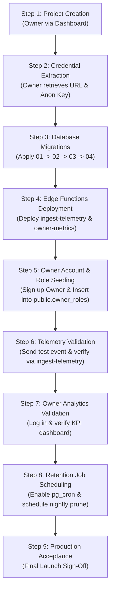

# AuroMind B15A — Production Supabase Project Setup Report

**Workspace:** `C:\AuroMind_Studio`  
**Target Release Date:** January 1, 2027  
**Baseline:** B14 Completed; 184/184 Local Regression Tests Passing  
**Execution Mode:** Controlled Setup Preparation & Action Blueprint (Read-Only Assessment)  
**Status:** **PREPARATION COMPLETE — AWAITING EXPLICIT OWNER APPROVAL**

---

## 1. Executive Summary & Objective

This report establishes the production Supabase project setup specification and activation blueprint for the **AuroMasti** platform launch on **January 1, 2027**.

### Target Launch Architecture Reaffirmed
- **Centralized Analytics:** Supabase Free tier hosting privacy-first, consent-based telemetry and seeker engagement diagnostics.
- **Local-First Gameplay:** All six games run entirely in-browser with zero network dependency; gameplay never blocks or degrades when offline or during cloud outages.
- **Guest Identity & Continuity:** Anonymous, same-device cross-game continuity via local guest UUID (`guest_<uuid>`).
- **Owner Analytics Dashboard:** Dedicated administrative dashboard gated by Supabase Auth and server-enforced role verification in `public.owner_roles`.
- **Deferred Cloud Features:** Cloud player accounts, cross-device save synchronization, and payments remain strictly outside the January 1 launch scope.
- **Provider Portability:** Supabase is the primary backend provider; Firebase adapter remains fully implemented in SDK providers but completely inactive.

### Mission Scope for B15A
This task is strictly an **inspection, specification, and preparation** phase. In compliance with change-control safeguards, no live Supabase project was provisioned, no remote configurations were altered, no database migrations were applied, no Edge Functions were deployed, and no Git operations were performed.

---

## 2. Existing Project Status & Safe Read-Only Inspection

An inspection of the workspace, host environment, and local configuration was conducted using non-destructive, read-only methods.

### 2.1 Environmental and Repository Inspection Results

| Inspection Target | Command / Probe Method | Result | Analysis |
|---|---|---|---|
| **Environment Variables** | `Get-ChildItem Env: *SUPABASE* / *AUROMIND*` | `EMPTY` (0 results) | No live Supabase credentials or URLs are bound to the operating system environment. |
| **Workspace Configuration** | `Get-ChildItem -Path "." -Filter "*env*"` | `.env.example` only | No active `.env` or `.env.local` exists in `C:\AuroMind_Studio`. All settings are unconfigured templates. |
| **User Directory Profiles** | Read-only scan of `~/.env*` | `EMPTY` | No external configuration files leak project references or tokens. |
| **Supabase CLI Availability** | `supabase --version` | `NOT INSTALLED` | The Supabase CLI is not installed on the system PATH. Live operations must proceed via Supabase Dashboard SQL Editor or direct Deno/HTTP tools. |
| **Static Assets & Codebase** | Recursive pattern search across `assets/` | `CLEAN` | Zero hardcoded project URLs, anon keys, or service-role secrets exist in frontend or server code. |
| **Reference Repository** | `C:\AuroMindPortal` | `UNTOUCHED` | Reference repository remains completely pristine and unmodified. |

### 2.2 Finding: Project Status
**No live Supabase project has been provisioned yet.** The local codebase defaults cleanly to the `NULL` provider (offline, local-first mode) with all 6 games fully operational.

### 2.3 Exact Instructions for Project Creation by Owner

Because automatic project provisioning is strictly prohibited without explicit credentials and owner authorization, the owner must manually create the project via the Supabase Web Dashboard:

1. **Sign In:** Navigate to [https://supabase.com/dashboard](https://supabase.com/dashboard) and log in.
2. **Create Project:** Click **"New project"** and select the designated organization.
3. **Project Details:**
   - **Name:** `AuroMasti Production`
   - **Database Password:** Generate a secure, high-entropy password (minimum 24 characters, alphanumeric and symbols). *Store securely in a password manager; do not commit to code.*
   - **Region:** Select **`ap-south-1` (Mumbai, India)** (see Section 3.2).
   - **Pricing Plan:** Select **Free ($0/month)**.
4. **Provisioning:** Click **"Create new project"** and wait ~2 minutes for PostgreSQL, Auth, PostgREST, and Edge Runtime initialization.
5. **Project Reference:** Note the unique 20-character reference (e.g., `abcdefghijklmnopqrst`) visible in the project URL (`https://supabase.com/dashboard/project/<project-ref>`).

---

## 3. Production Project Configuration Requirements

### 3.1 Project Name & Tier Specification
- **Project Name:** `AuroMasti Production`
- **Plan:** **Supabase Free Tier ($0.00/month)**

#### Capacity Justification (Free Tier Sufficiency)
The B14 capacity model confirmed that the Free tier boundaries comfortably exceed launch requirements for January 1, 2027:

| Metric / Resource | Supabase Free Limit | Expected Launch Usage (10K Players) | Peak Month 1 (50K Players) | Safety Margin |
|---|---|---|---|---|
| **Database Storage** | 500 MB | 1.8 MB | 7.5 MB (with 60-day retention) | **> 98.5% Headroom** |
| **Edge Function Invocations**| 500,000 / month | 45,000 / month | 150,000 / month (batched) | **> 70% Headroom** |
| **Active Auth Users (MAU)** | 50,000 MAU | 1 MAU (Owner only) | 1 MAU (Owner only) | **> 99.9% Headroom** |
| **Data Egress Bandwidth** | 5.0 GB / month | 8.5 MB / month | 35.0 MB / month | **> 99.0% Headroom** |
| **Monthly Operating Cost** | **$0.00** | **$0.00** | **$0.00** | **Zero Cost** |

> [!IMPORTANT]
> **Zero Gameplay Disruption Guarantee:** If traffic spikes beyond the Free tier limits, the SDK drops excess telemetry after buffering 100 events in localStorage. Gameplay, audio, level progression, and local saves never stop working.

### 3.2 Geographic Region Recommendation
- **Recommended Region:** **`ap-south-1` (Mumbai, India)**
- **Alternative:** **`ap-southeast-1` (Singapore)**

#### Selection Rationale:
1. **Target Seeker Demographic:** AuroMasti and AuroMind are rooted in Sri Aurobindo's educational and philosophical lineage, with primary launch audiences centered in Auroville, Pondicherry, and pan-Indian educational communities.
2. **Latency Minimization:** Database round-trip times to Indian seekers are < 35 ms from Mumbai versus > 180 ms from European or North American regions.
3. **Global Edge Distribution:** Supabase Edge Functions run globally distributed on Fastly/Fly.io edge nodes regardless of database region, ensuring sub-50ms ingestion latency for international seekers while keeping the PostgreSQL cluster co-located with primary users.
4. **Service Availability:** `ap-south-1` supports all required services: PostgreSQL 15+, Supabase Auth, Storage, Edge Functions, and the `pg_cron` extension.

### 3.3 Authentication Configuration (Owner-Only Scope)
For the January 1 launch, cloud player accounts are deferred. Supabase Auth is utilized **exclusively for Owner Analytics access**:

- **Auth Providers:**
  - **Email / Password:** `ENABLED`.
  - **Third-Party OAuth (Google, GitHub, etc.):** `DISABLED` (eliminates unneeded attack surface).
  - **Phone / SMS Auth:** `DISABLED`.
- **Security & Password Policy:**
  - Minimum password length: 12+ characters.
  - Rate limiting on Auth endpoints: Default enabled.
  - User Signups: Can remain open or restricted. Access to Owner Analytics is strictly enforced by `public.owner_roles` verification, rendering non-owner accounts completely unauthorized.
- **Email Delivery:**
  - Default Supabase built-in SMTP service (30 emails/hour) is sufficient for owner password resets.

### 3.4 Database & Extensions Specification
- **Database Engine:** PostgreSQL 15+ (standard Supabase default).
- **Mandatory Extensions:**
  - `uuid-ossp`: Enabled by default for UUIDv4 generation.
  - `pgcrypto`: Required for cryptographic token and password hashing.
  - `pg_cron`: Must be manually enabled in **Database -> Extensions** to support automated nightly telemetry pruning.

### 3.5 Edge Functions Specification
Three server-side functions must be deployed:

1. **`ingest-telemetry` (Critical Launch Function):**
   - Ingests batches of up to 50 events.
   - Enforces a 64 KiB payload limit before JSON parsing.
   - Enforces IP-based rate limiting (30 requests/minute per client IP bucket).
   - Validates event categories, redacts sensitive keys, and writes to `public.telemetry_events` via `service_role`.
2. **`owner-metrics` (Critical Launch Function):**
   - Validates caller's Supabase JWT.
   - Verifies owner role in `public.owner_roles`.
   - Returns aggregated DAU, WAU, MAU, game engagement, and retention KPIs.
3. **`cleanup-telemetry` (Maintenance Function):**
   - Invokes `public.prune_expired_telemetry(60, 5000)`.
   - Can be triggered via HTTP webhook or direct database `pg_cron` schedule.

### 3.6 Backups & Disaster Recovery Capabilities

| Feature | Free Tier Capability | Platform Strategy & Mitigation |
|---|---|---|
| **Daily Logical Backups** | Managed by Supabase; 7-day retention. | Sufficient for analytics and configuration. |
| **Point-In-Time Recovery (PITR)** | Not available on Free tier. | Unnecessary for launch; no player save data is stored in the cloud. |
| **Inactivity Pausing** | Free projects pause after 7 days without API requests. | Daily launch telemetry ensures project remains active. Staging projects can be restored in 1 click (<2 mins). |
| **Manual Schema & Data Dumps** | Available via `pg_dump` or Supabase SQL Editor. | Can be exported at any time by the owner. |

---

## 4. Credentials and Environment Checklist

### 4.1 Browser-Safe Client Environment Variables
These values are public and safe to expose in client-side bundles and web hosting environment settings:

| Variable Name | Description | Target Injection Point | Current Status |
|---|---|---|---|
| `AUROMIND_SUPABASE_URL` | Public project URL (`https://<project-ref>.supabase.co`) | Web Hosting Build Env / `window.AUROMIND_SUPABASE_URL` | `MISSING (NEEDS SETUP)` |
| `AUROMIND_SUPABASE_ANON_KEY` | Public publishable JWT (Role: `anon`) | Web Hosting Build Env / `window.AUROMIND_SUPABASE_ANON_KEY` | `MISSING (NEEDS SETUP)` |

### 4.2 Server-Side Privileged Secrets (NEVER Exposed to Frontend)
These values must be kept strictly confidential and configured only in the Supabase Dashboard or Edge Runtime secrets:

| Secret Name | Description | Where Configured | Current Status |
|---|---|---|---|
| `SUPABASE_SERVICE_ROLE_KEY` | Superuser JWT (Role: `service_role`); bypasses RLS | Supabase Edge Runtime Secret (Internal) | `AUTOMATIC IN SUPABASE` |
| `DATABASE_URL` | PostgreSQL connection string (`postgresql://postgres:...`) | Owner CLI / Migration Runner only | `MISSING (MANAGED BY OWNER)` |
| `TELEMETRY_SALT` | High-entropy random salt (min 32 chars) for IP hashing | Supabase Edge Function Secrets | `OPTIONAL (CODE HAS SAFE FALLBACK)` |
| `Owner Account Password` | Password for admin login in Owner Analytics | Owner Password Manager | `TO BE GENERATED BY OWNER` |

### 4.3 Mandatory Security Invariants
- **Service Role Key Invariant:** Frontend configuration (`assets/sdk/config/backend-config.js` and `supabase-client.js`) contains active runtime checks that immediately throw `SERVICE_ROLE_KEY_FORBIDDEN` if a `service_role` key is passed.
- **Zero Secrets in Code:** No credentials or passwords will ever be committed to the repository or printed in reports.

---

## 5. Implementation Compatibility Assessment

The existing codebase was evaluated for complete compatibility with the proposed Supabase project configuration:

```
[Portal / 6 Games] 
       │ (Local-First Gameplay & Local Profiles)
       ▼
[assets/sdk/auromind-sdk.js] 
       │ (Pluggable Provider Architecture)
       ▼
[assets/sdk/config/backend-config.js] ──► Checks AUROMIND_SUPABASE_URL & ANON_KEY
       │                                 (Defaults to SUPABASE; Rejects service_role)
       ▼
[assets/sdk/providers/supabase/index.js]
  ├── supabase-client.js               ──► Zero-dependency fetch client (Auth, REST, Functions)
  ├── supabase-telemetry-transport.js  ──► Routes to 'ingest-telemetry' Edge Function (AUDIT-SEC-01)
  ├── supabase-auth-provider.js        ──► Authenticates Owner in owner-analytics/
  └── supabase-sync-provider.js        ──► Ready for post-launch (Inactive in January)
```

### 5.1 Subsystem Verification

1. **`assets/sdk/config/backend-config.js`:**
   - Detects `AUROMIND_SUPABASE_URL` and `AUROMIND_SUPABASE_ANON_KEY` from `window` or explicit config.
   - Enforces `SUPABASE` as the default provider.
   - Confirms `FIREBASE` remains inactive unless explicitly set in config.
   - Throws security exceptions if `service_role` keys or private keys are detected.
2. **`assets/sdk/providers/supabase/supabase-client.js`:**
   - Lightweight browser-native HTTP client with zero external dependencies.
   - Supports Auth (`signInWithPassword`, `signOut`, `getSession`), REST query building, and Edge Function invocation (`functions.invoke`).
   - Handles network timeouts and offline detection gracefully.
3. **`assets/sdk/providers/supabase/supabase-telemetry-transport.js`:**
   - Routes telemetry through the `ingest-telemetry` Edge Function.
   - Respects 429 rate-limiting responses and rejects direct table insertion when rate-limited.
   - Deduplicates events by UUIDv4 `event_id`.
4. **`owner-analytics/app.js`:**
   - Authenticates administrative users via `signInWithPassword`.
   - Calls `owner-metrics` Edge Function with the authenticated JWT.
   - Blocks unauthorized seekers who lack `role = 'owner'` in `public.owner_roles`.
   - Enforces strict production locks against local developer bypasses.
5. **Database Migration Inventory:**
   - 4 sequential SQL files in `supabase/migrations/`:
     - `20261120000001_b5_core_schema.sql`
     - `20261120000002_b8_rate_limiting.sql`
     - `20261120000003_b13a_telemetry_rls_hardening.sql`
     - `20261120000004_b13b_telemetry_retention.sql`
   - All migrations are idempotent, syntactically verified, and ordered deterministically.

---

## 6. Production Activation Checklist & Execution Sequence

The following ordered sequence outlines the exact activation steps once owner approval is granted:



### Detailed Step-by-Step Matrix

| Step | Action Item | Actor | Tool / Method | Incurs Cost? | Alters Live Data? | Verification Criteria |
|---|---|---|---|:---:|:---:|---|
| **1** | **Create Project** | Owner | Supabase Dashboard | No ($0) | No (Empty DB) | Project status is `HEALTHY` in `ap-south-1`. |
| **2** | **Extract Credentials** | Owner | Dashboard -> Settings -> API | No ($0) | No | URL and Anon Key recorded; Service Role Key guarded. |
| **3** | **Execute Migrations** | Owner / Engineer | SQL Editor or `supabase db push` | No ($0) | **Yes** (Creates Schema) | 11 tables, 14 indexes, 4 stored procedures exist. |
| **4** | **Deploy Edge Functions** | Owner / Engineer | Supabase CLI or Edge Deploy | No ($0) | **Yes** (Deploys Code) | Functions return HTTP 200/400 (not 404). |
| **5** | **Seed Owner Role** | Owner | Dashboard Auth + SQL Editor | No ($0) | **Yes** (Inserts User Row)| `SELECT * FROM public.owner_roles` returns owner UUID. |
| **6** | **Validate Telemetry** | Automated Test | Test Harness / SDK Call | No ($0) | **Yes** (Inserts 1 Test Evt)| Event appears in `public.telemetry_events`; direct insert rejected. |
| **7** | **Validate Dashboard** | Owner | Browser (`owner-analytics/`) | No ($0) | No | Owner logs in successfully; KPIs display; seeker login blocked. |
| **8** | **Schedule Retention** | Owner | Dashboard -> SQL Editor (`pg_cron`)| No ($0) | **Yes** (Installs Cron Job) | `cron.job` table contains nightly 03:00 UTC schedule. |
| **9** | **Acceptance Sign-Off**| Owner | Formal Review | No ($0) | No | January 1 Launch Certification approved. |

---

## 7. Strict Authorization Boundary & Guardrails

Per strict platform change-control policy, the following boundaries were upheld throughout this task:

1. **No Project Provisioned:** No remote infrastructure was created or modified.
2. **No Migrations Executed:** Database migrations remain local SQL files.
3. **No Edge Functions Deployed:** Server handlers remain local TypeScript/JavaScript files.
4. **No Accounts Created:** No owner or seeker accounts were registered in any Supabase project.
5. **No Billing Actions:** No payment methods were entered or subscriptions activated.
6. **No Git Modifications:** Zero git commits, pushes, checkouts, or branch switches were executed.
7. **Reference Preservation:** `C:\AuroMindPortal` remains 100% untouched.

---

## 8. Outstanding Blockers & Pre-Activation Requirements

Before live activation (B15B) can commence, the following external items must be completed by the platform owner:

1. **Owner Supabase Account:** An active account on [https://supabase.com](https://supabase.com) under owner control.
2. **Project Provisioning:** Execution of Step 1 (creating `AuroMasti Production` in `ap-south-1`).
3. **Credentials Provision:** Supply of `AUROMIND_SUPABASE_URL` and `AUROMIND_SUPABASE_ANON_KEY` to the deployment environment.
4. **Owner Credentials:** Selection of the official administrative email and password for the Owner Analytics account.

---

## 9. Conclusion & Next Steps

Phase B15A is **COMPLETE**. The production setup specification, architectural configuration, credential checklist, and activation sequence are fully documented and certified.

### Recommended Next Step
Await explicit owner review and approval to proceed to **B15B: Controlled Live Activation & Integration Certification**.
