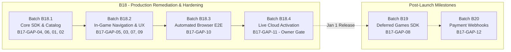

# B17 — AuroMind Remediation Roadmap & Execution Plan

**Programme:** AuroMind Production Readiness & Launch Certification  
**Target Release:** January 1, 2027  
**Canonical Workspace:** `C:\AuroMindPortal`  
**Active Git Branch:** `dev/studio-integration`  
**Audit Baseline:** B17 Master Audit (12 Registered Findings)  
**Roadmap Status:** **APPROVED FOR B18 SEQUENCING**

---

## 1. Remediation Sequencing Strategy

To ensure zero regressions, continuous test verification, and clean architectural layering, the 12 findings identified in B17 are organized into four sequential remediation batches (B18.1 through B18.4), followed by post-launch deferred batches (B19 and B20).

---

## 2. Batch Breakdown & Execution Specifications

### Batch B18.1 — Core SDK Integration & Catalog Cleanup
*Goal: Fix primary release blockers in SDK binding and clean up the portal catalog.*

| Task ID | Issue ID | Target Files | Remediation Description | Verification Criteria |
|---|---|---|---|---|
| **B18.1.1** | **B17-GAP-04** | `games/auroblocks/assets/auroblocks-sdk-bridge.js`, `games/auroblocks/index.html` | Create AuroBlocks SDK bridge. Register adapter with Shared SDK, link guest ID, and emit progression telemetry (`level_attempt`, `level_completed`, `score`). | `AuroMind.adapters.get('auroblocks')` returns registered adapter. New unit test in `b11-game-integration.test.js`. |
| **B18.1.2** | **B17-GAP-06** | `sw.js` | Update root Service Worker fetch handler to ensure `PORTAL_SDK_REL_PATHS` are served offline even when `request.referrer` contains `/games/`. | Simulated offline fetch of `assets/sdk/auromind-sdk.js` with game referrer returns 200 from cache. |
| **B18.1.3** | **B17-GAP-01** | `index.html` | Remove duplicate AuroBlocks card in Section 2 (lines 507–544). Retain primary card in Section 1. | `document.querySelectorAll('[data-game-id="auroblocks"]').length === 1`. "Live Now" filter displays 6 cards. |
| **B18.1.4** | **B17-GAP-02** | `index.html` | Align sidebar count text `All Games (33)` with curated card catalog. | Text in sidebar matches curated card count. |

*Exit Gate:* Run all 14 test suites (191+ tests); zero regressions.

---

### Batch B18.2 — In-Game Navigation & Accessibility Hardening
*Goal: Eliminate theater navigation traps and harmonize user preferences across iframes.*

| Task ID | Issue ID | Target Files | Remediation Description | Verification Criteria |
|---|---|---|---|---|
| **B18.2.1** | **B17-GAP-05** | `games/auroblocks/`, `games/auromatch/`, `games/auromandala/` | Implement in-game "Return to Portal" action in top menu/pause screens dispatching `AUROMIND_CLOSE_THEATER` via postMessage to parent. | Clicking exit within each game closes theater and returns to catalog. |
| **B18.2.2** | **B17-GAP-03** | `assets/css/portal.css` | Increase touch target size of console edge tab on viewports `<600px` (`width: 36px`, `height: 56px`, `border-radius: 0 12px 12px 0`). | Tab is readily tappable on mobile without triggering edge back swipe. |
| **B18.2.3** | **B17-GAP-07** | `assets/js/portal.js`, child game adapters | Broadcast `AUROMIND_SET_SENIOR_MODE` message to active iframe when toggled in portal. Child adapters adjust CSS variables for font scale/contrast. | Senior Mode toggle changes child game UI contrast/text size dynamically. |
| **B18.2.4** | **B17-GAP-09** | `assets/js/portal.js` | Track `ambientAudioWasPlaying` flag in portal audio controller. Auto-resume 432 Hz procedural audio on `closeTheater()`. | Exiting game theater restores background ambient audio if previously playing. |

*Exit Gate:* Regression test run; verify postMessage bridge tests pass in `b11-game-integration.test.js`.

---

### Batch B18.3 — Automated Browser End-to-End Test Suite
*Goal: Bridge the gap between Node VM tests and real browser engines.*

| Task ID | Issue ID | Target Files | Remediation Description | Verification Criteria |
|---|---|---|---|---|
| **B18.3.1** | **B17-GAP-10** | `e2e/`, `package.json` | Add Playwright test harness with 3 core specs: (1) Portal catalog render & category filter, (2) Game theater iframe launch & exit, (3) Service Worker offline precache validation. | `npx playwright test` passes cleanly in headless Chromium and WebKit. |

*Exit Gate:* Playwright tests green; zero flakiness.

---

### Batch B18.4 — Live Supabase Production Activation (Owner Gate)
*Goal: Connect the validated local platform to real Supabase Free cloud infrastructure.*

| Task ID | Issue ID | Target Area | Remediation Description | Verification Criteria |
|---|---|---|---|---|
| **B18.4.1** | **B17-GAP-11** | Supabase Dashboard | Owner provisions `AuroMasti Production` in `ap-south-1` (Mumbai). | Project created on Supabase Free tier. |
| **B18.4.2** | **B17-GAP-11** | SQL Migrations | Apply migrations `20261120000001` through `20261120000004` via Supabase CLI or SQL Editor. | All 9 tables, indexes, triggers, and RLS policies created. |
| **B18.4.3** | **B17-GAP-11** | Edge Functions | Deploy Edge Functions: `ingest-telemetry`, `owner-metrics`, `cleanup-telemetry`, `sync-save`, `delete-account`, `verify-entitlements`. | Functions active with secrets configured. |
| **B18.4.4** | **B17-GAP-11** | Owner Role Seeding | Insert owner's authenticated user ID into `public.owner_roles`. | Owner Analytics dashboard logs in with server authorization. |
| **B18.4.5** | **B17-GAP-11** | Production Hosting | Populate `AUROMIND_SUPABASE_URL` and `AUROMIND_SUPABASE_ANON_KEY` in static hosting ingress. | Telemetry events successfully ingested into live DB. |

*Exit Gate:* End-to-end live telemetry ingestion test; verified Owner Analytics display.

---

## 3. Post-Launch Deferred Batches

### Batch B19 — Deferred Titles Modernization (Post-January 1, 2027)
- **B17-GAP-08:** Author Shared SDK adapter bridges for Word Riddle (`games/word-riddle/`) and VAK Living Sanctuary (`games/vak-living-sanctuary/`).
- Formalize cloud sync schemas and regression tests for these two titles.

### Batch B20 — Commercialization & Payment Webhooks (Future Milestone)
- **B17-GAP-12:** Implement Stripe Checkout and App Store/Google Play server webhook Edge Functions to populate `public.entitlements` upon verified purchase.
