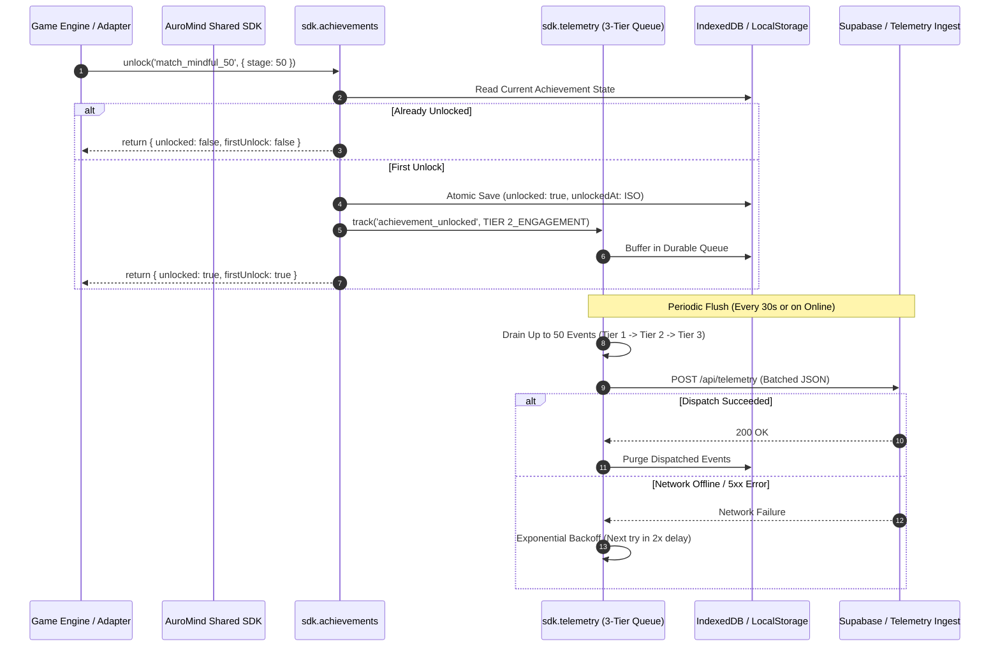

# AuroMasti B18-B1 — Achievements & Telemetry Contracts
## Comprehensive Architecture Design for F-06 and F-08

- **Document Version:** 1.0.0
- **Batch Reference:** AuroMasti B18-B1 (Read-Only Architecture & Blueprint)
- **Target Branch:** `dev/studio-integration`
- **Canonical Workspace:** `C:\AuroMindPortal`
- **Target Release:** January 1, 2027
- **Findings Addressed:**
  - **F-06 (P2):** Shared SDK Achievements Service Missing Formal Contract & Offline Deduplication
  - **F-08 (P3):** Telemetry In-Memory Queue Overflow, Drop Policy, & Privacy Leakage Risks

---

## 1. Executive Summary & Architectural Scope

In AuroMasti's local-first, offline-capable architecture, player progression spans both discrete game milestones (e.g., clearing 50 levels in AuroMatch, composing a sacred geometry mandala, or completing daily speech practice in VAK) and cross-platform telemetry events. Prior to B18-B1, the achievements mechanism lacked a formal API contract, relying on disparate ad-hoc keys in `localStorage`, while the telemetry subsystem in `assets/sdk/auromind-sdk.js` maintained an unprioritized in-memory queue capped arbitrarily at 200 items that discarded recent events when full, lacked offline durability across tab reloads, and had no formal privacy gate excluding sensitive inputs.

This specification establishes:
1. **The AuroMind Shared SDK Achievements Contract (`sdk.achievements`)**: A fully typed, idempotent, offline-first achievement management system supporting atomic unlocks, progress tracking, cross-game query APIs, local persistence via IndexedDB/localStorage fallback, and conflict-free monotonic cloud synchronization.
2. **The Robust Telemetry Service Contract (`sdk.telemetry`)**: A 3-tier prioritized queue architecture (CRITICAL, ENGAGEMENT, DIAGNOSTIC) with deterministic FIFO eviction of low-priority events, bounded durable offline buffering, batched delivery with exponential backoff, and strict architectural data-loss/privacy gates (guaranteeing that Sankalpa Vault inputs, private journal entries, and raw speech audio are never logged or transmitted).

---

## 2. Shared SDK Achievements Service Contract (F-06)

### 2.1 Architectural Invariants
1. **Local-First & Offline Resilience:** Achievement unlocks and progress updates MUST succeed instantly in local storage without requiring network connectivity.
2. **Idempotence:** Unlocking an already-unlocked achievement or incrementing progress with duplicate event keys MUST NOT produce duplicate records, inflate counters, or emit redundant notifications.
3. **Monotonic Progression:** Achievement unlock status is strictly monotonic: once unlocked, an achievement CANNOT be locked by remote sync or merge unless an explicit administrative reset is requested.
4. **Envelope Integration:** Game-specific achievements are tracked within game save envelopes under `gameSave.achievements`, while cross-game/meta achievements reside in the Portal root save envelope (`auromind_meta_save_v1`).
5. **No Visual Intrusion During Meditative Gameplay:** Achievement notifications MUST respect the user's focus state and "Senior Mode / Calm Mode" settings, suppressing disruptive toast popups during active meditation sessions in AuroMandala or VAK Sanctuary.

### 2.2 Formal Achievement Data Model

```typescript
export type AchievementTier = 'BRONZE' | 'SILVER' | 'GOLD' | 'PLATINUM' | 'SACRED';
export type AchievementCategory = 'PROGRESSION' | 'MASTERY' | 'CONSISTENCY' | 'MEDITATION' | 'SPECIAL';

export interface AchievementDefinition {
  id: string;                      // Globally unique key: e.g., 'match_zen_master_50'
  gameId: string;                  // 'auroblocks' | 'auromatch' | 'auromandala' | 'vak' | 'word-riddle' | 'vak-living-sanctuary' | 'portal'
  title: string;                   // Localized display title
  description: string;             // Condition description
  tier: AchievementTier;
  category: AchievementCategory;
  secret: boolean;                 // Hidden until unlocked
  iconUri: string;                 // Asset URI
  maxProgress: number;             // E.g., 50 for 50 levels (1 for binary unlocks)
  points: number;                  // Gamification score weight
}

export interface PlayerAchievementState {
  achievementId: string;
  gameId: string;
  unlocked: boolean;
  unlockedAt: string | null;       // ISO 8601 UTC timestamp
  currentProgress: number;         // 0 <= currentProgress <= maxProgress
  lastProgressUpdate: string;      // ISO 8601 UTC timestamp
  syncState: 'LOCAL_ONLY' | 'PENDING_SYNC' | 'SYNCED';
  metadata?: Record<string, unknown>; // Optional contextual tags (e.g., stageId)
}

export interface AchievementStoreEnvelope {
  schemaVersion: number;           // 1
  guestId: string;
  achievements: Record<string, PlayerAchievementState>; // Keyed by achievementId
  checksum: string;                // SHA-256 canonical hash
  lastModified: string;
}
```

### 2.3 SDK Achievements Interface Specification (`sdk.achievements`)

```javascript
/**
 * AuroMind Shared SDK - Achievements Service Interface
 */
class AuroMindAchievementsService {
  /**
   * Initializes the achievements service with game-specific or portal definitions.
   * @param {Object} options
   * @param {string} options.gameId - The requesting game ID
   * @param {AchievementDefinition[]} options.definitions - Registry of achievements
   * @param {Function} [options.onUnlock] - Optional notification hook
   */
  async init(options);

  /**
   * Unlocks an achievement immediately or marks it pending completion.
   * Idempotent: Subsequent calls for already-unlocked achievements are no-ops.
   * @param {string} achievementId
   * @param {Record<string, unknown>} [context]
   * @returns {Promise<{ unlocked: boolean, firstUnlock: boolean, state: PlayerAchievementState }>}
   */
  async unlock(achievementId, context = {});

  /**
   * Increments progress towards a tiered achievement.
   * Automatically triggers unlock() if currentProgress >= maxProgress.
   * @param {string} achievementId
   * @param {number} amount - Positive incremental value
   * @param {Record<string, unknown>} [context]
   * @returns {Promise<{ state: PlayerAchievementState, justUnlocked: boolean }>}
   */
  async incrementProgress(achievementId, amount = 1, context = {});

  /**
   * Sets absolute progress towards a tiered achievement.
   * Monotonic: Progress will not regress unless force=true.
   * @param {string} achievementId
   * @param {number} absoluteValue
   * @param {boolean} [force=false]
   * @returns {Promise<{ state: PlayerAchievementState, justUnlocked: boolean }>}
   */
  async setProgress(achievementId, absoluteValue, force = false);

  /**
   * Retrieves current state for a specific achievement.
   * @param {string} achievementId
   * @returns {PlayerAchievementState | null}
   */
  getAchievement(achievementId);

  /**
   * Returns all achievements for the current game or platform.
   * @param {Object} [filter]
   * @param {string} [filter.gameId]
   * @param {boolean} [filter.unlockedOnly]
   * @returns {PlayerAchievementState[]}
   */
  getAllAchievements(filter = {});

  /**
   * Calculates platform gamer score / total mastery points.
   * @param {string} [gameId]
   * @returns {{ totalPoints: number, unlockedCount: number, availableCount: number }}
   */
  calculateScore(gameId);

  /**
   * Merges incoming remote achievements envelope during cloud sync.
   * Applies monotonic union (Max Progress, Earliest Unlock Timestamp).
   * @param {AchievementStoreEnvelope} remoteEnvelope
   * @returns {AchievementStoreEnvelope} Merged local envelope
   */
  mergeRemoteAchievements(remoteEnvelope);
}
```

### 2.4 Canonical Cross-Game Achievement Registry

| Game ID | Achievement ID | Title | Tier | Condition |
| :--- | :--- | :--- | :--- | :--- |
| **AuroMatch** | `match_zen_journey` | Zen Journey Begins | BRONZE | Clear Level 1 |
| **AuroMatch** | `match_mindful_50` | Mindful Harmonizer | GOLD | Clear Level 50 without hints |
| **AuroBlocks** | `blocks_first_flow` | First Geometric Flow | BRONZE | Clear 5 lines in a single game |
| **AuroBlocks** | `blocks_centurion` | Geometric Master | GOLD | Reach high score of 10,000 |
| **AuroMandala** | `mandala_first_light` | Sacred Spark | BRONZE | Save your first mandala artwork |
| **AuroMandala** | `mandala_sacred_circle` | Yantra Weaver | SACRED | Complete 10 unique geometric mandalas |
| **VAK** | `vak_voice_awakening` | Voice of Truth | BRONZE | Complete first speech session |
| **VAK** | `vak_100_levels` | Master of Sound | PLATINUM | Complete 100 phoneme exercises |
| **Word Riddle** | `riddle_insight` | First Awakening | BRONZE | Solve 5 spiritual riddles |
| **VAK Sanctuary** | `sanctuary_presence`| Silent Presence | BRONZE | Spend 15 minutes in meditation |
| **Portal** | `portal_harmonious_unity`| AuroMasti Explorer | PLATINUM | Launch all 6 games in the portal |

### 2.5 Conflict-Free Merging Algorithm (Monotonic Union)

When merging local and remote achievement envelopes, the SDK executes the following deterministic reconciliation:
$$\text{MergedState}(A) = \begin{cases} 
\text{unlocked} = \text{local.unlocked} \lor \text{remote.unlocked} \\
\text{unlockedAt} = \min(\text{local.unlockedAt}, \text{remote.unlockedAt}) \\
\text{currentProgress} = \max(\text{local.currentProgress}, \text{remote.currentProgress}) \\
\text{lastProgressUpdate} = \max(\text{local.lastProgressUpdate}, \text{remote.lastProgressUpdate})
\end{cases}$$

This guarantees that:
- An achievement unlocked offline is never revoked by a stale cloud snapshot.
- Progress counters never regress.
- Historical unlock timestamps preserve the true earliest moment of achievement.

---

## 3. Telemetry Service & Prioritized Queue Specification (F-08)

### 3.1 Defect Analysis of Legacy Telemetry (`assets/sdk/auromind-sdk.js`)
Inspection of `assets/sdk/auromind-sdk.js` revealed:
```javascript
// Legacy implementation:
this.eventQueue = [];
this.maxQueueSize = 200;
// When length exceeds maxQueueSize:
if (this.eventQueue.length > this.maxQueueSize) {
  this.eventQueue.shift(); // Drops oldest event regardless of severity!
}
```
**Architectural Flaws Identified:**
1. **Critical Data Loss:** If network is unavailable during prolonged gameplay, high-value events (e.g., save write failures, corrupted envelope recoveries, security integrity alerts) are dropped indiscriminately alongside high-frequency diagnostic events.
2. **Volatile Queue Storage:** Queue exists purely in RAM; closing or reloading the browser tab completely wipes pending events.
3. **No Backpressure or Batching Semantics:** Events are dispatched one-by-one or dumped on unload via `navigator.sendBeacon` without compression or retry logic.
4. **Privacy Blindspot:** No hardcoded filter preventing developers or game adapters from passing sensitive inputs into telemetry payloads.

### 3.2 3-Tier Priority Telemetry Queue Design

To guarantee reliability and data safety, telemetry events are classified into three strict priority tiers:

```
+--------------------------------------------------------------------------------+
|                             AUROMIND TELEMETRY QUEUE                           |
+--------------------------------------------------------------------------------+
|  [TIER 1: CRITICAL] (Capacity: 100 events)                                     |
|  - Save corruptions, cryptographic checksum failures, storage quota errors,   |
|    fatal application crashes, auth token revocations.                          |
|  - EVICTION POLICY: NEVER EVICT. Persisted across reloads in IndexedDB.        |
+--------------------------------------------------------------------------------+
|  [TIER 2: ENGAGEMENT] (Capacity: 300 events)                                   |
|  - Game session start/end, level completed, achievement unlocked,              |
|    senior mode toggled, return-to-portal navigation.                           |
|  - EVICTION POLICY: FIFO within Tier 2 when queue reaches capacity.            |
+--------------------------------------------------------------------------------+
|  [TIER 3: DIAGNOSTIC] (Capacity: 100 events)                                   |
|  - Frame performance, asset load latency, audio context resumes, UI clicks.   |
|  - EVICTION POLICY: Aggressively evicted first upon total buffer pressure.     |
+--------------------------------------------------------------------------------+
```

### 3.3 Event Schema & Privacy Boundary Gate

```typescript
export type TelemetryPriority = 'CRITICAL' | 'ENGAGEMENT' | 'DIAGNOSTIC';

export interface TelemetryEvent {
  eventId: string;                 // UUIDv4
  priority: TelemetryPriority;
  eventName: string;               // E.g., 'level_completed', 'save_corruption_detected'
  gameId: string;                  // 'auromatch', 'auroblocks', etc.
  timestamp: string;               // ISO 8601 UTC
  guestId: string;                 // Anonymous player hash (never PII)
  sessionId: string;               // Ephemeral session UUID
  schemaVersion: number;           // 1
  payload: Record<string, unknown>; // Sanitized metadata
}
```

#### Strict Privacy Filter Invariant (Sacred Privacy Boundary)
The telemetry dispatcher enforces a mandatory sanitization pipeline before any event enters the queue:

```javascript
const FORBIDDEN_TELEMETRY_KEYS = [
  'sankalpa',
  'intention',
  'vault',
  'audio_blob',
  'audio_buffer',
  'speech_recording',
  'strokes',
  'canvas_data',
  'mandala_svg',
  'journal',
  'password',
  'token',
  'email',
  'name'
];

function sanitizeTelemetryPayload(payload) {
  if (!payload || typeof payload !== 'object') return {};
  const clean = {};
  for (const [key, value] of Object.entries(payload)) {
    const lowerKey = key.toLowerCase();
    // 1. Drop forbidden sensitive keys
    if (FORBIDDEN_TELEMETRY_KEYS.some(forbidden => lowerKey.includes(forbidden))) {
      continue;
    }
    // 2. Prevent deep object leaks: serialize primitives and safe metrics only
    if (typeof value === 'object' && value !== null) {
      if (Array.isArray(value)) {
        clean[key] = value.length; // Log array counts, not raw contents
      } else {
        clean[key] = sanitizeTelemetryPayload(value);
      }
    } else {
      clean[key] = value;
    }
  }
  return clean;
}
```

### 3.4 Bounded Queue Eviction & Durability Algorithm

When a new telemetry event is pushed to the queue:
1. **Payload Sanitization:** Run `sanitizeTelemetryPayload(payload)`.
2. **Buffer Capacity Check:**
   - Total capacity is capped at **500 events** (RAM) and stored in `indexedDB('auromind_telemetry_store')`.
   - If total count $\ge 500$:
     1. Evict oldest **DIAGNOSTIC (Tier 3)** event.
     2. If no DIAGNOSTIC events exist, evict oldest **ENGAGEMENT (Tier 2)** event.
     3. **CRITICAL (Tier 1)** events are NEVER evicted. If the queue consists solely of 100 CRITICAL events, subsequent CRITICAL events overwrite the oldest CRITICAL event with a logged `queue_saturation_warning`.
3. **Dispatch & Retry Loop:**
   - Active network: Batch dispatch up to 50 events per HTTP POST every 30 seconds.
   - Offline: Retain in durable storage; pause dispatch timer until `navigator.onLine` emits `online`.
   - On page unload (`visibilitychange` / `pagehide`): Flush up to 20 highest-priority events using `navigator.sendBeacon`.

---

## 4. Interaction Architecture: Achievements & Telemetry



---

## 5. Verification Checklist & Quality Gates

- [ ] `sdk.achievements.init()` registers definitions without polluting global namespace.
- [ ] Multiple rapid calls to `unlock()` for the same ID execute idempotently with zero state mutation.
- [ ] Tiered progress monotonically increments and triggers unlock upon threshold without regression.
- [ ] Sankalpa Vault, private mandala strokes, and raw speech audio are 100% stripped by telemetry sanitizer.
- [ ] 500-event queue saturation drops Tier 3 diagnostic events first, preserving Tier 1 critical errors.
- [ ] Page refresh during offline mode restores pending critical telemetry events from IndexedDB.
