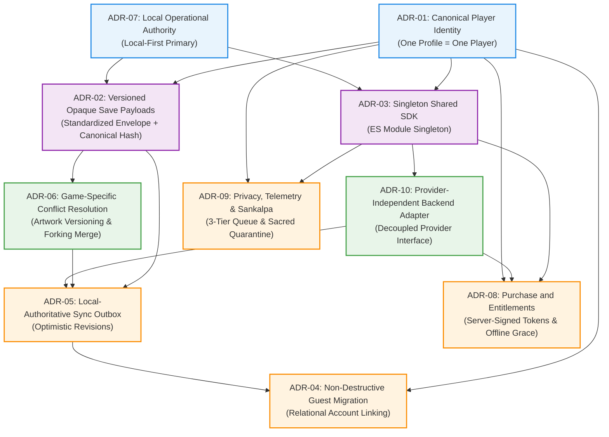

# AuroMasti B18-B1 — ADR Dependency & Decision Matrix
## Governance Analysis, Inter-ADR Graph & Approval Sequencing

- **Document Version:** 1.0.0
- **Batch Reference:** B18-B1 Formal Architecture Decision Review
- **Canonical Workspace:** `C:\AuroMindPortal`
- **Target Release:** January 1, 2027
- **Governance Mandate:** All 10 original ADRs remain **PENDING OWNER APPROVAL**. This matrix provides the structured decision parameters and dependency topology to guide the Product Owner's review.

---

## 1. Topological ADR Dependency Graph

The 10 original ADRs form a coherent, layered architecture. Foundational decisions on identity and local authority establish the base for save formatting and SDK contracts, which in turn support conflict handling, backend independence, entitlements, and cloud sync:



---

## 2. Recommended Owner Approval Sequence

To prevent circular dependencies and ensure that prerequisite contracts are locked before dependent cloud designs are approved, the owner is advised to review and approve the ADRs in the following four topological waves:

```
┌──────────────────────────────────────────────────────────────────────────────┐
│ WAVE 1: FOUNDATION LAYER (Zero External Dependencies)                        │
│ 1. ADR-01: Canonical Player Identity Model                                   │
│ 2. ADR-07: Local Operational Authority                                       │
├──────────────────────────────────────────────────────────────────────────────┤
│ WAVE 2: CLIENT CONTRACT & ENVELOPE LAYER (Depends on Wave 1)                 │
│ 3. ADR-02: Versioned Opaque Save Payloads                                    │
│ 4. ADR-03: Singleton Shared SDK                                              │
├──────────────────────────────────────────────────────────────────────────────┤
│ WAVE 3: LOGIC, RECONCILIATION & ABSTRACTION (Depends on Waves 1 & 2)          │
│ 5. ADR-06: Game-Specific Conflict Resolution (Artwork Versioning)             │
│ 6. ADR-10: Provider-Independent Backend Adapter                              │
├──────────────────────────────────────────────────────────────────────────────┤
│ WAVE 4: SERVICES, SYNC, COMMERCE & PRIVACY (Depends on Waves 1, 2 & 3)       │
│ 7. ADR-05: Local-Authoritative Sync Outbox                                   │
│ 8. ADR-04: Non-Destructive Guest Identity Migration                          │
│ 9. ADR-09: Privacy, Telemetry and Sankalpa Exclusion                         │
│ 10. ADR-08: Purchase and Entitlement Architecture                            │
└──────────────────────────────────────────────────────────────────────────────┘
```

---

## 3. Comprehensive ADR Decision Matrix

| ADR # | Canonical Decision Title | Recommendation | Owning Phase | Prerequisite Dependencies | Relevant Findings | Remaining Open Questions |
|:---:|:---|:---:|:---:|:---|:---|:---|
| **ADR-01** | Canonical Player Identity Model | **Approve with conditions** | **B18-B1** | None (Base Root) | F-04, F-05 | Does the owner want a visible "Identity Reset / New Journey" button in Settings, or strictly rely on browser data clear? |
| **ADR-02** | Versioned Opaque Save Payloads | **Approve with conditions** | **B18-B1** | ADR-01, ADR-07 | F-01, F-02, F-03 | Should legacy save archives (`localStorage` un-enveloped keys) be retained indefinitely or purged after 90 days? |
| **ADR-03** | Singleton Shared SDK | **Approve with conditions** | **B18-B1** | ADR-01, ADR-07 | F-03, F-06, F-08 | Should SDK emit a custom DOM event (`auromind:ready`) or strictly rely on window-level promise? |
| **ADR-04** | Non-Destructive Guest Identity Migration | **Approve with conditions** | **B18-B** | ADR-01, ADR-05 | F-01, F-07 | When linking a device to an account that already has saves, should the user review an itemized diff modal or execute automatic domain merge? |
| **ADR-05** | Local-Authoritative Sync Outbox | **Approve with conditions** | **B18-B1** / **B18-B** | ADR-02, ADR-06, ADR-10 | F-02, F-04 | What maximum retry duration before the outbox switches to low-frequency background polling (e.g. 15 minutes)? |
| **ADR-06** | Game-Specific Conflict Resolution | **Approve with conditions** | **B18-B1** | ADR-02 | F-01, F-07 | In AuroMandala forked conflicts, should forked copies have an auto-generated tag or prompt the user for a new name? |
| **ADR-07** | Local Operational Authority | **Approve with conditions** | **B18-B1** | None (Base Root) | F-04, F-05, F-09 | Should the portal warn the user if `navigator.storage.persist()` is denied by browser settings? |
| **ADR-08** | Purchase and Entitlement Architecture | **Approve with conditions** | **B18-B1** / **B18-B** | ADR-01, ADR-03, ADR-10 | Architecture Gaps | Does the owner wish to keep commercial gates strictly off (`COMMERCIAL_GATE_ENABLED: false`) for the entire 2027 beta? |
| **ADR-09** | Privacy, Telemetry and Sankalpa Exclusion | **Approve with conditions** | **B18-B1** | ADR-01, ADR-03 | F-08, Sacred Invariants | Should telemetry opt-out default to true in EU/GDPR jurisdictions before prompt? |
| **ADR-10** | Provider-Independent Backend Adapter | **Approve with conditions** | **B18-B1** / **B18-B** | ADR-03 | F-03, F-09 | When Supabase is provisioned in B18-C, should the provider mock remain available via an admin query flag (`?mock=true`)? |

---

## 4. Deep Decision Parameters by ADR

### 4.1 ADR-01: Canonical Player Identity Model
- **Original Decision:** Single persistent anonymous guest identity (`guest_<uuidv4>`) per browser profile, dual-persisted to IndexedDB and localStorage, coordinated via Web Locks.
- **Evidence:** `assets/sdk/auromind-sdk.js` lines 140–310; `server.test.js` tests 1–17.
- **Findings Mapped:** F-04 (Storage resilience), F-05 (Auto-healing).
- **Benefits:** Frictionless play, instant onboarding, unified cross-game settings and progression.
- **Trade-offs:** Wiped on explicit browser site data purge unless backed up to cloud.
- **Security Implications:** Zero PII, anonymous cryptographic random identifier.
- **Data-Integrity Implications:** Web Locks eliminate multi-tab initialization race conditions.
- **Recommended Decision:** **APPROVE WITH CONDITIONS**
- **Approval Conditions:** Add `navigator.storage.persist()` registration; preserve single profile rule.
- **Phase:** Phase B18-B1.
- **Acceptance Criteria:** Identity generation, multi-tab lock, and dual-store auto-healing pass 100% of automated tests.

### 4.2 ADR-02: Versioned Opaque Save Payloads
- **Original Decision:** Standardized `GameSaveEnvelope` with opaque game payloads, schema versioning, and integrity checksums.
- **Evidence:** `assets/sdk/auromind-adapters.js`; `server.test.js` tests 22–24.
- **Findings Mapped:** F-01 (Artwork protection), F-02 (Canonical SHA-256), F-03 (Missing adapters).
- **Benefits:** Decouples platform sync engine from diverse game genre data models.
- **Trade-offs:** Opaque payloads require registered adapter merge logic for deep property merges.
- **Security Implications:** Payloads must exclude local-only vaults (Sankalpa).
- **Data-Integrity Implications:** Checksum validation detects data corruption before saves are applied.
- **Recommended Decision:** **APPROVE WITH CONDITIONS**
- **Approval Conditions:** Mandate canonical JSON key sorting and SHA-256 computation excluding transport fields.
- **Phase:** Phase B18-B1.
- **Acceptance Criteria:** Mutating deeply nested payload changes hash; mutating transport metadata leaves hash identical.

### 4.3 ADR-03: Singleton Shared SDK
- **Original Decision:** Framework-agnostic ES module singleton (`AuroMindSDK`) exposing frozen sub-services.
- **Evidence:** `assets/sdk/auromind-sdk.js`; `assets/js/portal.js`; E2E Suite C tests 1–3.
- **Findings Mapped:** F-03 (Standalone adapters), F-06 (Achievements API), F-08 (Telemetry queue).
- **Benefits:** Single point of contract enforcement; prevents script collision; ensures consistent UX.
- **Trade-offs:** Initialization bugs could affect downstream services if not isolated.
- **Security Implications:** `Object.freeze` prevents prototype pollution and method tampering.
- **Data-Integrity Implications:** All saves pass through validated invariant checks.
- **Recommended Decision:** **APPROVE WITH CONDITIONS**
- **Approval Conditions:** Include local mock fallbacks in all bridges to preserve standalone offline gameplay; add `sdk.achievements`.
- **Phase:** Phase B18-B1.
- **Acceptance Criteria:** Standalone game launch without portal initializes cleanly and saves progress offline.

### 4.4 ADR-04: Non-Destructive Guest Identity Migration
- **Original Decision:** Relational `guest_identity_links` join table linking guestId to authenticated cloud user without overwriting local progress.
- **Evidence:** `assets/sdk/migration/backend-migration.js`; `server.test.js` migration tests.
- **Findings Mapped:** F-01 (Artwork protection), F-07 (Domain merge).
- **Benefits:** Eliminates first-login data wipe; preserves local guest achievements.
- **Trade-offs:** Requires relational link management in PostgreSQL.
- **Security Implications:** Verification of account credentials and device authorization.
- **Data-Integrity Implications:** Local saves are preserved even if cloud linking network call times out.
- **Recommended Decision:** **APPROVE WITH CONDITIONS**
- **Approval Conditions:** Client migration must be atomic; failure leaves local saves untouched; ADR-06 merges apply if cloud has existing saves.
- **Phase:** Phase B18-B (Cloud Integration Design).
- **Acceptance Criteria:** Linking existing guest with 50 completed levels to new cloud account preserves all 50 levels locally and in cloud.

### 4.5 ADR-05: Local-Authoritative Sync Outbox
- **Original Decision:** Offline outbox with optimistic revision concurrency (`expectedRevision = baseRevision`) and HTTP 409 conflict detection.
- **Evidence:** `assets/sdk/auromind-sdk.js` lines 540–660; `server.test.js` B8 Security tests.
- **Findings Mapped:** F-02 (Canonical SHA-256), F-04 (Storage resilience).
- **Benefits:** Instant local gameplay writes; non-blocking background synchronization; zero gameplay lag.
- **Trade-offs:** Requires conflict handling when multiple offline devices reconnect.
- **Security Implications:** Outbox payloads validated against schema limits before network transmission.
- **Data-Integrity Implications:** Prevents older offline devices from overwriting newer cloud saves.
- **Recommended Decision:** **APPROVE WITH CONDITIONS**
- **Approval Conditions:** Outbox queue must be persisted in IndexedDB; offline gameplay must never be blocked by queue state.
- **Phase:** Phase B18-B1 (Client Outbox Durability) & Phase B18-B (Cloud RPC Design).
- **Acceptance Criteria:** 10 saves executed while offline queue reliably and synchronize in order upon reconnection.

### 4.6 ADR-06: Game-Specific Conflict Resolution
- **Original Decision:** Non-destructive Invariants 1–4 with delegation to registered game merge strategies.
- **Evidence:** `assets/sdk/auromind-adapters.js`; `games/auromandala/assets/auromandala-sdk-bridge.js`.
- **Findings Mapped:** F-01 (Artwork protection), F-07 (Domain merge policies).
- **Benefits:** Domain-accurate reconciliation; for AuroMandala, conflicting artworks fork into separate local copies, guaranteeing zero artwork loss.
- **Trade-offs:** Requires maintaining bespoke merge strategies for each of the six games.
- **Security Implications:** Merged payloads re-validated and re-checksummed before local or cloud commit.
- **Data-Integrity Implications:** Zero silent overwrite of user creations or higher level progression.
- **Recommended Decision:** **APPROVE WITH CONDITIONS**
- **Approval Conditions:** Implement versioned artwork schema with UUIDv4 keys and conflict forking for AuroMandala; define bespoke merge rules for all 6 games.
- **Phase:** Phase B18-B1.
- **Acceptance Criteria:** Conflicting artwork edits produce forked local copy with `(Cloud Copy)` tag; no artwork is ever overwritten.

### 4.7 ADR-07: Local Operational Authority
- **Original Decision:** Local client storage is the primary authority; cloud is a durable synchronization replica.
- **Evidence:** `portal.js`; `sw.js`; `auromind-sdk.js`; 251 passing offline tests.
- **Findings Mapped:** F-04 (Storage resilience), F-05 (Auto-healing), F-09 (CSP).
- **Benefits:** 100% offline operability, zero gameplay latency, immunity to cloud downtime.
- **Trade-offs:** Requires robust conflict resolution when reconnecting.
- **Security Implications:** Local storage protected against XSS via strict CSP.
- **Data-Integrity Implications:** Local data is never overwritten without cryptographic validation.
- **Recommended Decision:** **APPROVE WITH CONDITIONS**
- **Approval Conditions:** Mandatory `navigator.storage.persist()` registration; storage health indicator in Portal Settings.
- **Phase:** Phase B18-B1.
- **Acceptance Criteria:** Entire platform boots and all 6 games play with zero internet connectivity.

### 4.8 ADR-08: Purchase and Entitlement Architecture
- **Original Decision:** Free beta access initially; server-verified, cryptographically signed receipts when commercialization is activated.
- **Evidence:** `assets/sdk/config/backend-config.js` (`COMMERCIAL_GATE_ENABLED: false`); `server.test.js` entitlement queries.
- **Findings Mapped:** Additional Architecture Gaps (Purchase Security & Entitlements).
- **Benefits:** Frictionless launch; robust tamper-resistant foundation ready for future premium content.
- **Trade-offs:** Requires maintaining offline entitlement verification and key rotation logic.
- **Security Implications:** Client-side flags forbidden; server-issued signed JWT tokens with Ed25519/RS256; device-clock manipulation defense.
- **Data-Integrity Implications:** Revoked purchases disable access gracefully without deleting user creations.
- **Recommended Decision:** **APPROVE WITH CONDITIONS**
- **Approval Conditions:** Provider-independent client contract in B18-B1; server verification architecture in B18-B; master gate remains toggleable.
- **Phase:** Phase B18-B1 (Client Contract) & Phase B18-B (Cloud Architecture).
- **Acceptance Criteria:** Offline player retains purchased entitlements for 30-day grace period; clock rollback detected and mitigated.

### 4.9 ADR-09: Privacy, Telemetry and Sankalpa Exclusion
- **Original Decision:** Zero PII, explicit user consent, bounded ingestion, and absolute Sankalpa Vault exclusion.
- **Evidence:** `assets/sdk/auromind-sdk.js`; `backend-config.js`; `server.test.js` B10 & B8 tests.
- **Findings Mapped:** F-08 (Telemetry queue & privacy), Sacred Invariants (Sankalpa).
- **Benefits:** Preserves sacred contemplative atmosphere; complies with GDPR/COPPA; guarantees user prayer confidentiality.
- **Trade-offs:** Lower diagnostic resolution due to strict payload size and redaction rules.
- **Security Implications:** Sankalpa Vault is strictly local-only with E2EE (AES-GCM-256).
- **Data-Integrity Implications:** Telemetry dispatch runs during browser idle frames, never impacting gameplay performance.
- **Recommended Decision:** **APPROVE WITH CONDITIONS**
- **Approval Conditions:** 3-tier queue (CRITICAL, ENGAGEMENT, DIAGNOSTIC) capped at 500 events; automated pre-queue privacy sanitizer.
- **Phase:** Phase B18-B1.
- **Acceptance Criteria:** Telemetry queue saturation drops Tier 3 events first; sensitive keys (`sankalpa`, journal, audio) are 100% stripped.

### 4.10 ADR-10: Provider-Independent Backend Adapter
- **Original Decision:** Provider Adapter Pattern decoupling all games and shared services from concrete cloud SDKs.
- **Evidence:** `assets/sdk/config/backend-config.js`; `server.test.js` conformance tests.
- **Findings Mapped:** F-03 (Missing adapters), F-09 (Production CSP).
- **Benefits:** Prevents vendor lock-in; enables flawless local offline testing; allows backend migration without rewriting game engines.
- **Trade-offs:** Requires maintaining abstraction interfaces and error mapping.
- **Security Implications:** Client configuration throws security violations if private/service-role keys are detected.
- **Data-Integrity Implications:** Network errors normalized into standard platform error codes handled by the local outbox.
- **Recommended Decision:** **APPROVE WITH CONDITIONS**
- **Approval Conditions:** Supabase remains the preferred cloud candidate, but provisioning and activation remain strictly blocked until Phase B18-C approval.
- **Phase:** Phase B18-B1 (Contract Hardening) & Phase B18-B (Cloud Integration Design).
- **Acceptance Criteria:** Swapping adapter configuration from `supabase` to `mock` or `firebase` requires zero changes to game code.
