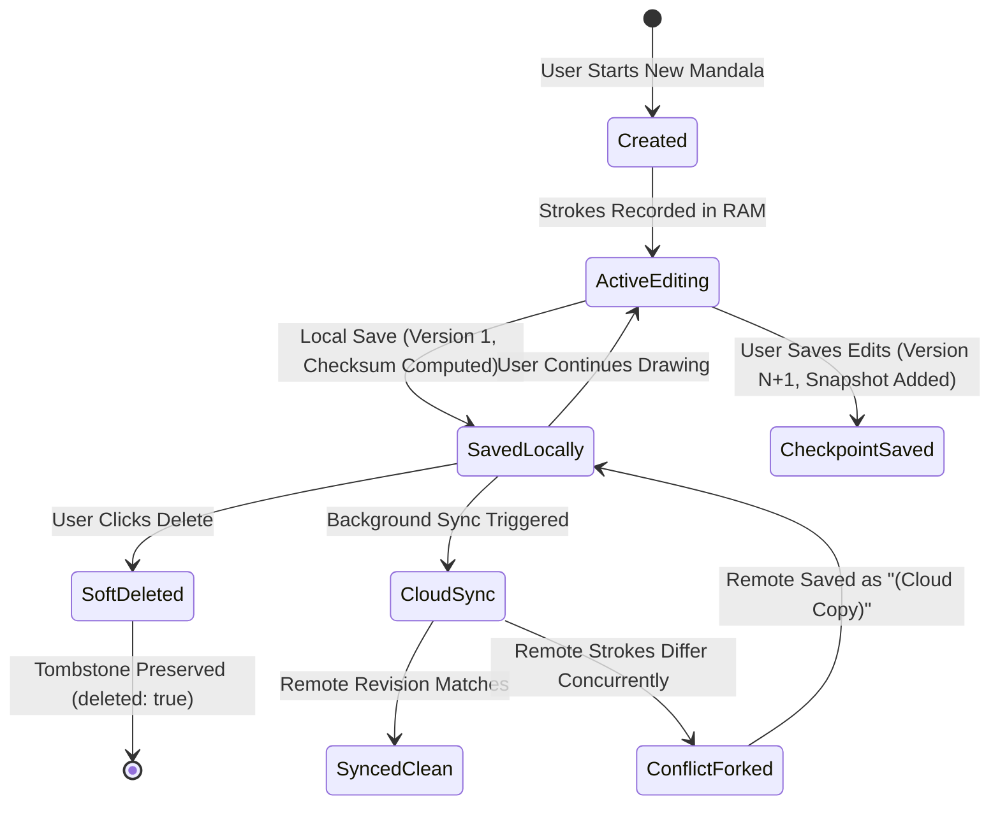

# AuroMasti B18-B1 — AuroMandala Artwork Protection Final Specification
## Complete Lifecycle, Versioning Model, and Non-Destructive Conflict Forking (ADR-06)

- **Document Version:** 1.0.0
- **Batch Reference:** B18-B1 Final ADR Clarification & Approval Preparation
- **Canonical Workspace:** `C:\AuroMindPortal`
- **Target Release:** January 1, 2027
- **Owner Selected Policy:** **Versioned Artwork with Conflict Recovery**
- **Governance Status:** PENDING OWNER APPROVAL

---

## 1. Architectural Mandates & Non-Negotiables

In AuroMandala, players invest contemplative hours crafting intricate geometric and spiritual mandalas. The Product Owner has established the following **absolute invariants**:

```
┌─────────────────────────────────────────────────────────────────────────────────┐
│                    SACRED ARTWORK INVARIANTS (ZERO DATA LOSS)                   │
├─────────────────────────────────────────────────────────────────────────────────┤
│ 1. NEVER SILENTLY OVERWRITE: No sync, merge, or reload operation may ever       │
│    overwrite or discard local artwork strokes without explicit player consent. │
│ 2. NEVER SILENTLY DELETE: Deletions require explicit user action and are        │
│    recorded as soft-delete tombstones; stale snapshots cannot revive them.      │
│ 3. ZERO LOSS ON FAILED SYNC: Local artwork remains 100% intact if network       │
│    drops, times out, or returns a 5xx error during cloud transit.               │
│ 4. FORK ON CONFLICT: If local and cloud versions diverge concurrently, the      │
│    cloud version is forked into a new independent artwork with a display label. │
└─────────────────────────────────────────────────────────────────────────────────┘
```

---

## 2. Complete Artwork Data Model Specification

The legacy schema stored artworks in an unindexed array (`savedArtworks: [...]`), which made entity-level tracking impossible. The new schema restructures artworks into an indexed entity dictionary keyed by immutable UUIDv4:

```typescript
export interface MandalaStroke {
  id: string;                      // Stroke UUID
  tool: string;                    // Brush / symmetry tool identifier
  color: string;                   // Hex / RGBA color
  width: number;
  points: Array<{ x: number, y: number, pressure?: number }>;
  timestamp: number;
}

export interface ArtworkVersionSnapshot {
  version: number;                 // Monotonic integer (1, 2, 3...)
  title: string;
  strokesHash: string;             // SHA-256 of strokes array
  createdAt: string;               // ISO-8601 UTC
}

export interface VersionedArtworkEntity {
  artworkId: string;               // Immutable UUIDv4
  title: string;                   // User-defined display title
  currentVersion: number;          // Monotonic integer starting at 1
  createdAt: string;               // ISO-8601 UTC
  updatedAt: string;               // ISO-8601 UTC
  deleted: boolean;                // Soft-delete tombstone flag
  deletedAt: string | null;        // ISO-8601 UTC when deleted
  strokes: MandalaStroke[];        // Active artwork strokes array
  strokesHash: string;             // SHA-256 hash of canonicalized strokes
  history: ArtworkVersionSnapshot[]; // Immutable historical checkpoints (up to 10)
  metadata: {
    symmetryOrder: number;         // Geometry symmetry setting (e.g. 8, 12, 16)
    aspectRatio: string;           // E.g., '1:1'
    canvasPreset: string;
    forkedFromId?: string;         // Origin artworkId if created via conflict fork
  };
}

export interface AuroMandalaSavePayload {
  highestStageCleared: number;
  totalTimeSpentSeconds: number;
  sessions: Array<{ id: string, timestamp: string, duration: number }>;
  artworks: Record<string, VersionedArtworkEntity>; // Keyed by artworkId (UUIDv4)
  activeArtworkId: string | null;
}
```

---

## 3. The Complete Artwork Lifecycle



### 3.1 Creation & Editing Workflow
1. When a player begins a new canvas, the bridge generates an `artworkId` using `crypto.randomUUID()`.
2. Initial save sets `currentVersion = 1`, `deleted = false`, and records the initial snapshot in `history`.
3. Subsequent editing sessions append a new `ArtworkVersionSnapshot` to `history` (capped at the 10 most recent versions to prevent unbounded storage growth), increment `currentVersion`, and update `updatedAt`.

### 3.2 Deletion & Tombstone Protocol
When a player deletes an artwork:
- The artwork is **NOT** physically removed from the JSON dictionary immediately.
- The record is flagged: `deleted = true`, `deletedAt = new Date().toISOString()`, and `strokes = []` (releasing memory).
- **Tombstone Sync Defense:** When cloud sync reconciles with a remote device that still has the old artwork marked `deleted = false`, the sync engine observes the tombstone timestamp (`deletedAt > remote.updatedAt`) and commits the deletion to the cloud, preventing ghost resurrections.
- Tombstones older than **90 days** are purged during scheduled maintenance if all synced replicas have acknowledged the deletion.

### 3.3 Conflict Forking Protocol (Concurrent Edits)
When local artwork $A_{\text{local}}$ and remote artwork $A_{\text{remote}}$ share the same `artworkId`, but possess different `strokesHash` values:
1. **Never Overwrite:** Local artwork $A_{\text{local}}$ remains active and untouched on the player's device.
2. **Fork Creation:** The incoming remote artwork $A_{\text{remote}}$ is minted as a new independent artwork entity $A_{\text{forked}}$:
   - $A_{\text{forked}}.\text{artworkId} = \text{crypto.randomUUID()}$ (Completely new unique ID).
   - $A_{\text{forked}}.\text{title} = A_{\text{remote}}.\text{title} + \text{" (Cloud Copy)"}$.
   - $A_{\text{forked}}.\text{metadata.forkedFromId} = A_{\text{local}}.\text{artworkId}$.
   - $A_{\text{forked}}.\text{history} = A_{\text{remote}}.\text{history}$.
3. **Notification:** The player is alerted in the Gallery view that an alternate version created on another device was saved alongside their local mandala.
4. **Independent Evolution:** From that point forward, both artworks evolve as distinct independent entities.

### 3.4 Version Restoration Workflow
The AuroMandala Gallery UI provides a *"Version History"* drawer:
- Displays up to 10 historical snapshots with timestamp and thumbnail preview.
- Clicking *"Restore this version"* creates a new monotonic version:
  - `currentVersion = currentVersion + 1`.
  - Strokes are restored from the selected snapshot.
  - A new history checkpoint is appended.
  - Historical records are never destructively overwritten.

---

## 4. Test Scenarios & Acceptance Matrix

| Scenario ID | Test Scenario | Execution Steps | Expected Architectural Outcome |
| :--- | :--- | :--- | :--- |
| **TC-MANDALA-01** | Simultaneous Editing on Two Devices | Device A edits Mandala `M1` offline (Strokes A); Device B edits `M1` offline (Strokes B); both reconnect. | Invariant 4 triggers: Local `M1` (Strokes A) preserved; incoming Strokes B forked into new entity `M1 (Cloud Copy)` with unique UUIDv4. Zero strokes lost. |
| **TC-MANDALA-02** | Deletion vs. Editing Conflict | Device A soft-deletes `M1` at 10:00 UTC; Device B adds strokes to `M1` at 10:05 UTC; both sync. | Timestamp comparison: Device B's update ($10:05 > 10:00$) supersedes deletion tombstone; `M1` resurrected with updated strokes; tombstone revoked. |
| **TC-MANDALA-03** | Interrupted Cloud Sync | Sync outbox starts uploading 5 MB artwork payload; network drops mid-stream (TCP reset). | Local save remains 100% intact; outbox buffers operation; retry with exponential backoff; local user continues drawing unhindered. |
| **TC-MANDALA-04** | Historical Version Restoration | Player draws version 1, edits to version 2, edits to version 3; player clicks "Restore Version 1". | Version 4 created containing Version 1 strokes; history retains snapshots for V1, V2, V3; non-destructive restoration verified. |
| **TC-MANDALA-05** | Deep Checksum Verification | Player changes single point in a single stroke of an existing artwork. | Checksum calculation deeply hashes `artworks[id].strokes`; checksum changes; outbox marks artwork as dirty for sync. |
