# AuroMasti B18-B1 — Dependency & Execution Sequence
## Topological Task Sequencing, Dependency DAG, and Integration Checkpoints

- **Document Version:** 1.0.0
- **Batch Reference:** B18-B1 Master Implementation Execution Plan
- **Canonical Workspace:** `C:\AuroMindPortal`
- **Target Release:** January 1, 2027
- **Governance Mandate:** All 10 original ADRs remain **PENDING OWNER APPROVAL**. This document defines the exact topological execution sequence to guide implementation upon authorization.

---

## 1. Topological Dependency Analysis & Core Principles

To prevent regressions, broken interfaces, and circular dependencies, engineering execution **must not be ordered merely by priority (P1/P2/P3)**. Foundational identity contracts, canonical serialization, and SDK singleton structures must be stabilized and tested before dependent game adapters, domain merge policies, and commerce services are authored.

### Execution Principles:
1. **Foundations First:** Base hashing (`TASK-SAVE-01`) and identity locking (`TASK-ID-01`) precede all game bridges.
2. **Parallel Adapter Implementation:** Once the core SDK contracts are locked (Stage 2), all six game bridges (`TASK-ADP-01` through `TASK-ADP-05` and `TASK-ART-01`) can be authored independently in parallel.
3. **Reconciliation After Adaptation:** Domain merge policies (`TASK-SYNC-01`) and artwork conflict forking (`TASK-ART-02`) execute only after game save envelopes are operational.
4. **Integration Checkpoints:** Formal quality gates halt execution if any test fails before advancing to the next stage.

---

## 2. Mermaid Dependency Directed Acyclic Graph (DAG)

```mermaid
flowchart TD
    %% Stage 1: Foundation Layer
    subgraph STAGE_1["Stage 1: Foundation Layer"]
        T_ID01["TASK-ID-01: Identity Multi-Tab Web Locks"]
        T_SAVE01["TASK-SAVE-01: Canonical JSON & SHA-256 Engine"]
        T_CSP01["TASK-CSP-01: Multi-Host Production CSP Headers"]
    end

    %% Stage 2: SDK Core & Storage Resilience
    subgraph STAGE_2["Stage 2: SDK Core & Resilience"]
        T_ID02["TASK-ID-02: Storage Persistence & Quota"]
        T_ID03["TASK-ID-03: Ephemeral RAM Mode & Backup UI"]
        T_SDK01["TASK-SDK-01: SDK Singleton Hardening"]
        T_SDK02["TASK-SDK-02: Standalone Game Mock Fallback"]
    end

    %% Stage 3: Game Adapters & Save Integrations
    subgraph STAGE_3["Stage 3: Six Game Adapters"]
        T_ADP01["TASK-ADP-01: AuroBlocks Bridge Update"]
        T_SAVE02["TASK-SAVE-02: AuroMatch Auto-Healing Fix"]
        T_ADP02["TASK-ADP-02: AuroMatch SDK Bridge"]
        T_ADP03["TASK-ADP-03: VAK Speech SDK Bridge"]
        T_ADP04["TASK-ADP-04: Word Riddle SDK Bridge"]
        T_ADP05["TASK-ADP-05: VAK Sanctuary SDK Bridge"]
        T_SAVE03["TASK-SAVE-03: Save Corruption Quarantine"]
        T_ART01["TASK-ART-01: AuroMandala UUIDv4 Artwork Schema"]
    end

    %% Stage 4: Synchronization & Merge Engine
    subgraph STAGE_4["Stage 4: Sync & Merge Engine"]
        T_SYNC01["TASK-SYNC-01: Six-Game Bespoke Merges"]
        T_SYNC02["TASK-SYNC-02: Durable Outbox in IDB"]
        T_ART02["TASK-ART-02: AuroMandala Conflict Forking"]
    end

    %% Stage 5: Services & Commerce
    subgraph STAGE_5["Stage 5: Services & Commerce"]
        T_ACH01["TASK-ACH-01: Achievements Service"]
        T_TEL01["TASK-TEL-01: 3-Tier Telemetry Queue"]
        T_TEL02["TASK-TEL-02: Telemetry Privacy & Sankalpa E2EE"]
        T_COMM01["TASK-COMM-01: Purchases Interface & Mock Engine"]
        T_COMM02["TASK-COMM-02: Ed25519 Token Verification"]
    end

    %% Stage 6: Final Verification
    subgraph STAGE_6["Stage 6: Platform Verification"]
        T_REG01["TASK-REG-01: Full Regression & Sacred Invariant Gate"]
    end

    %% Dependencies
    T_ID01 --> T_ID02
    T_ID01 --> T_ID03
    T_ID01 --> T_SDK01
    T_SAVE01 --> T_SDK01
    T_SDK01 --> T_SDK02

    T_SAVE01 --> T_ADP01
    T_SDK02 --> T_ADP01
    T_SAVE01 --> T_SAVE02
    T_SAVE02 --> T_ADP02
    T_SDK02 --> T_ADP02
    T_SAVE01 --> T_ADP03
    T_SDK02 --> T_ADP03
    T_SAVE01 --> T_ADP04
    T_SDK02 --> T_ADP04
    T_SAVE01 --> T_ADP05
    T_SDK02 --> T_ADP05
    T_SAVE01 --> T_SAVE03
    T_SAVE01 --> T_ART01

    T_ADP01 --> T_SYNC01
    T_ADP02 --> T_SYNC01
    T_ADP03 --> T_SYNC01
    T_ADP04 --> T_SYNC01
    T_ADP05 --> T_SYNC01
    T_ART01 --> T_SYNC01
    T_ID01 --> T_SYNC02
    T_SAVE01 --> T_SYNC02
    T_ART01 --> T_ART02
    T_SYNC01 --> T_ART02

    T_SDK01 --> T_ACH01
    T_SAVE01 --> T_ACH01
    T_SDK01 --> T_TEL01
    T_TEL01 --> T_TEL02
    T_SDK01 --> T_COMM01
    T_COMM01 --> T_COMM02

    T_CSP01 --> T_REG01
    T_ID02 --> T_REG01
    T_ID03 --> T_REG01
    T_SYNC01 --> T_REG01
    T_SYNC02 --> T_REG01
    T_ART02 --> T_REG01
    T_ACH01 --> T_REG01
    T_TEL02 --> T_REG01
    T_COMM02 --> T_REG01
```



---

## 3. Seven Implementation Stages & Checkpoint Gates

```
┌─────────────────────────────────────────────────────────────────────────────────┐
│ STAGE 1: FOUNDATION LAYER (Tasks: ID-01, SAVE-01, CSP-01)                       │
│ - Execution: Parallel independent authoring.                                    │
│ - Focus: Canonical JSON, Web Crypto SHA-256, Web Locks identity, multi-host CSP.│
│ - Checkpoint Gate 1: Cryptographic hashing and identity convergence verified.   │
├─────────────────────────────────────────────────────────────────────────────────┤
│ STAGE 2: SDK CORE & STORAGE RESILIENCE (Tasks: ID-02, ID-03, SDK-01, SDK-02)    │
│ - Execution: Sequential after Stage 1.                                          │
│ - Focus: `navigator.storage.persist()`, quota monitor, RAM fallback, mocks.    │
│ - Checkpoint Gate 2: SDK singleton frozen; standalone mock loads offline.       │
├─────────────────────────────────────────────────────────────────────────────────┤
│ STAGE 3: SIX GAME ADAPTERS (Tasks: ADP-01 to ADP-05, SAVE-02, SAVE-03, ART-01) │
│ - Execution: Highly parallel across game directories.                           │
│ - Focus: Author missing bridge files (VAK, Riddle, Sanctuary), AuroMatch fix.  │
│ - Checkpoint Gate 3: All 6 games extract valid envelopes with SHA-256 hashes.  │
├─────────────────────────────────────────────────────────────────────────────────┤
│ STAGE 4: SYNC OUTBOX & MERGE ENGINE (Tasks: SYNC-01, SYNC-02, ART-02)          │
│ - Execution: Sequential after Stage 3 adapters are operational.                 │
│ - Focus: Bespoke merges for 6 games, outbox IDB queue, artwork conflict fork.   │
│ - Checkpoint Gate 4: Zero-loss merge verified; conflicting mandalas fork.       │
├─────────────────────────────────────────────────────────────────────────────────┤
│ STAGE 5: ACHIEVEMENTS & PRIVACY (Tasks: ACH-01, TEL-01, TEL-02)                 │
│ - Execution: Parallel after Stage 2.                                            │
│ - Focus: `sdk.achievements`, 3-tier queue (500 events), Sankalpa Vault E2EE.    │
│ - Checkpoint Gate 5: Telemetry queue drops Tier 3 first; sensitive keys purged. │
├─────────────────────────────────────────────────────────────────────────────────┤
│ STAGE 6: COMMERCE & ENTITLEMENTS (Tasks: COMM-01, COMM-02)                      │
│ - Execution: Parallel after Stage 2.                                            │
│ - Focus: Provider-independent purchase interface, Mock provider, Ed25519 JWT.   │
│ - Checkpoint Gate 6: Entitlements verified offline; launch gate remains off.    │
├─────────────────────────────────────────────────────────────────────────────────┤
│ STAGE 7: INTEGRATION & PLATFORM REGRESSION (Task: REG-01)                       │
│ - Execution: Final verification gate across the entire platform.                │
│ - Focus: All 251 baseline tests + 42 new assertions; sacred data invariants.   │
│ - Checkpoint Gate 7: 100% pass rate; zero byte drift; release ready.           │
└─────────────────────────────────────────────────────────────────────────────────┘
```

---

## 4. Workstream Parallelism & Independent Task Analysis

### Tasks That Can Run Concurrently in Parallel:
- `TASK-ID-01`, `TASK-SAVE-01`, and `TASK-CSP-01` (Stage 1): Zero mutual dependencies.
- `TASK-ADP-01`, `TASK-ADP-02`, `TASK-ADP-03`, `TASK-ADP-04`, `TASK-ADP-05`, and `TASK-ART-01` (Stage 3): Completely isolated file sets in separate game directories.
- `TASK-ACH-01`, `TASK-TEL-01`, and `TASK-COMM-01` (Stages 5 & 6): Independent shared service modules.

### Strictly Sequential Tasks:
- `TASK-SAVE-01` MUST complete before any adapter task (`TASK-ADP-*`).
- `TASK-SAVE-02` (AuroMatch fix) MUST complete before `TASK-ADP-02` (AuroMatch bridge).
- `TASK-ART-01` (Mandala schema) MUST complete before `TASK-ART-02` (Mandala conflict forking).
- All adapter tasks (`TASK-ADP-*`) MUST complete before `TASK-SYNC-01` (Domain merges).
- All tasks MUST complete before `TASK-REG-01` (Final verification).
