# AuroMasti B18-B1 — Final Dependency Graph
## Complete Task-Level Dependency Topology, Parallelism Analysis, and Unsimplified Critical Path

- **Document Version:** 1.0.0
- **Batch Reference:** B18-B1 Implementation Plan Reconciliation & Final Acceptance
- **Canonical Workspace:** `C:\AuroMindPortal`
- **Active Git Branch:** `dev/studio-integration`
- **Target Release:** January 1, 2027
- **Canonical Task Count:** 24 Tasks across 11 Workstreams (A through K)
- **Governance Mandate:** All 10 original ADRs remain **PENDING OWNER APPROVAL**.

---

## 1. Unsimplified Critical Path Analysis

The critical path represents the longest chain of strictly sequential dependent tasks that dictates the minimum implementation duration for Phase B18-B1:

```
┌─────────────────────────────────────────────────────────────────────────────────┐
│                       B18-B1 UNSIMPLIFIED CRITICAL PATH                         │
└──────────────────────────────────────┬──────────────────────────────────────────┘
                                       │
                                       ▼
    1. TASK-SAVE-01: Canonical JSON Serialization & Web Crypto SHA-256 Engine
       (Foundational hashing required by envelope validator and all 6 adapters)
                                       │
                                       ▼
    2. TASK-SDK-01: Shared SDK Singleton Hardening & Frozen Sub-Services
       (Core singleton required to expose interfaces and mock fallbacks)
                                       │
                                       ▼
    3. TASK-SDK-02: Standalone Game Mock Fallback Engine
       (Base mock engine embedded into all 6 game bridges)
                                       │
                                       ▼
    4. TASK-ADP-03 / 04 / 05 & TASK-ART-01: Author Missing Bridges & Mandala Schema
       (Physical authoring of game adapters extracting standard envelopes)
                                       │
                                       ▼
    5. TASK-SYNC-01: Six-Game Bespoke Domain Merge Policies
       (Reconciliation logic operating across all six standardized envelopes)
                                       │
                                       ▼
    6. TASK-ART-02: AuroMandala Conflict Forking & Tombstone Deletion Sync
       (Entity-level forking and tombstone sync requiring domain merge engine)
                                       │
                                       ▼
    7. TASK-REG-01: Platform-Wide Regression & Sacred Invariant Verification Gate
       (Full automated test execution verifying 293 tests and 0 regressions)
```

---

## 2. Complete Task-Level Dependency Graph (DAG)

```mermaid
flowchart TD
    %% Base Cryptographic & Core Services
    T_SAVE01["TASK-SAVE-01<br/>Canonical JSON & SHA-256"]
    T_ID01["TASK-ID-01<br/>Identity Web Locks"]
    T_CSP01["TASK-CSP-01<br/>Multi-Host CSP Configs"]

    %% Storage Resilience & SDK Core
    T_ID02["TASK-ID-02<br/>Storage Persistence & Quota"]
    T_ID03["TASK-ID-03<br/>Ephemeral RAM Mode & UI"]
    T_SDK01["TASK-SDK-01<br/>SDK Singleton Hardening"]
    T_SDK02["TASK-SDK-02<br/>Standalone Mock Fallback"]

    %% Save Integrity Fixes
    T_SAVE02["TASK-SAVE-02<br/>AuroMatch Auto-Heal Fix"]
    T_SAVE03["TASK-SAVE-03<br/>Corrupt Save Quarantine"]

    %% Six Game Adapters
    T_ADP01["TASK-ADP-01<br/>AuroBlocks Bridge Update"]
    T_ADP02["TASK-ADP-02<br/>AuroMatch SDK Bridge"]
    T_ADP03["TASK-ADP-03<br/>VAK Speech SDK Bridge"]
    T_ADP04["TASK-ADP-04<br/>Word Riddle SDK Bridge"]
    T_ADP05["TASK-ADP-05<br/>VAK Sanctuary SDK Bridge"]
    T_ART01["TASK-ART-01<br/>AuroMandala UUIDv4 Schema"]

    %% Merges & Outbox
    T_SYNC01["TASK-SYNC-01<br/>Six-Game Domain Merges"]
    T_SYNC02["TASK-SYNC-02<br/>Durable Outbox in IDB"]
    T_ART02["TASK-ART-02<br/>AuroMandala Conflict Forking"]

    %% Platform Services
    T_ACH01["TASK-ACH-01<br/>Achievements Service"]
    T_TEL01["TASK-TEL-01<br/>3-Tier Telemetry Queue"]
    T_TEL02["TASK-TEL-02<br/>Telemetry Privacy & Sanitizer"]
    T_COMM01["TASK-COMM-01<br/>Purchases Mock Interface"]
    T_COMM02["TASK-COMM-02<br/>Ed25519 Token Verification"]

    %% Final Verification
    T_REG01["TASK-REG-01<br/>Full Regression Gate"]

    %% Dependency Edges
    T_ID01 --> T_ID02
    T_ID01 --> T_ID03
    T_ID01 --> T_SDK01
    T_SAVE01 --> T_SDK01
    T_SDK01 --> T_SDK02

    T_SAVE01 --> T_SAVE02
    T_SAVE01 --> T_SAVE03

    T_SAVE01 --> T_ADP01
    T_SDK02 --> T_ADP01

    T_SAVE02 --> T_ADP02
    T_SDK02 --> T_ADP02

    T_SAVE01 --> T_ADP03
    T_SDK02 --> T_ADP03

    T_SAVE01 --> T_ADP04
    T_SDK02 --> T_ADP04

    T_SAVE01 --> T_ADP05
    T_SDK02 --> T_ADP05

    T_SAVE01 --> T_ART01

    T_ADP01 --> T_SYNC01
    T_ADP02 --> T_SYNC01
    T_ADP03 --> T_SYNC01
    T_ADP04 --> T_SYNC01
    T_ADP05 --> T_SYNC01
    T_ART01 --> T_SYNC01

    T_ID01 --> T_SYNC02
    T_SAVE01 --> T_SYNC02

    T_ART01 --> T_ART02
    T_SYNC01 --> T_ART02

    T_SDK01 --> T_ACH01
    T_SAVE01 --> T_ACH01

    T_SDK01 --> T_TEL01
    T_TEL01 --> T_TEL02

    T_SDK01 --> T_COMM01
    T_COMM01 --> T_COMM02

    %% Edges into Final Regression Gate
    T_CSP01 --> T_REG01
    T_ID02 --> T_REG01
    T_ID03 --> T_REG01
    T_SAVE03 --> T_REG01
    T_SYNC01 --> T_REG01
    T_SYNC02 --> T_REG01
    T_ART02 --> T_REG01
    T_ACH01 --> T_REG01
    T_TEL02 --> T_REG01
    T_COMM02 --> T_REG01

    %% Styling
    classDef foundation fill:#e1f5fe,stroke:#0288d1,stroke-width:2px;
    classDef adapters fill:#f3e5f5,stroke:#7b1fa2,stroke-width:2px;
    classDef merges fill:#e8f5e9,stroke:#388e3c,stroke-width:2px;
    classDef services fill:#fff3e0,stroke:#f57c00,stroke-width:2px;
    classDef gate fill:#ffebee,stroke:#d32f2f,stroke-width:3px;

    class T_SAVE01,T_ID01,T_CSP01,T_ID02,T_ID03,T_SDK01,T_SDK02 foundation;
    class T_SAVE02,T_SAVE03,T_ADP01,T_ADP02,T_ADP03,T_ADP04,T_ADP05,T_ART01 adapters;
    class T_SYNC01,T_SYNC02,T_ART02 merges;
    class T_ACH01,T_TEL01,T_TEL02,T_COMM01,T_COMM02 services;
    class T_REG01 gate;
```



---

## 3. Parallel Execution Clusters & Independent Tasks

### Cluster 1: Foundational Independence (Can execute concurrently)
- `TASK-SAVE-01` (Canonical JSON Hashing): Affects `assets/sdk/auromind-adapters.js`.
- `TASK-ID-01` (Identity Web Locks): Affects `assets/sdk/auromind-sdk.js`.
- `TASK-CSP-01` (Multi-Host CSP): Affects `server.js`, `vercel.json`, `_headers`, `netlify.toml`.
*These three tasks have zero mutual dependencies and can be worked on simultaneously.*

### Cluster 2: Six Game Adapter Bridges (Can execute concurrently)
Once Stage 2 is complete (`TASK-SDK-02` mock fallback available):
- `TASK-ADP-01` (AuroBlocks bridge)
- `TASK-ADP-02` (AuroMatch bridge)
- `TASK-ADP-03` (VAK Speech bridge)
- `TASK-ADP-04` (Word Riddle bridge)
- `TASK-ADP-05` (VAK Sanctuary bridge)
- `TASK-ART-01` (AuroMandala UUIDv4 schema)
*All six adapters modify completely isolated files in separate `games/*/` directories and can be implemented in parallel.*

### Cluster 3: Independent Platform Services
- `TASK-ACH-01` (Achievements API): Operates independently of commerce and telemetry.
- `TASK-TEL-01` & `TASK-TEL-02` (Telemetry queue & privacy filter): Operates independently of achievements.
- `TASK-COMM-01` & `TASK-COMM-02` (Commerce mock & Ed25519 token verification): Operates independently of telemetry and achievements.

---

## 4. Work Unblocked by Outstanding ADR Decisions

While the Product Owner reviews the four specific policy choices:
1. **Unblocked Work:** 20 out of 24 tasks (`TASK-ID-01`, `TASK-ID-02`, `TASK-SAVE-01..03`, `TASK-SDK-01..02`, `TASK-ADP-01..05`, `TASK-SYNC-01..02`, `TASK-ART-01`, `TASK-ACH-01`, `TASK-COMM-01`, `TASK-TEL-02`, `TASK-CSP-01`) depend on foundational engineering standards (UUIDv4, canonical JSON, Web Crypto, Web Locks) and are **completely unblocked** by the specific policy choices.
2. **Blocked Work:** Only 4 tasks have specific parameter dependencies:
   - `TASK-ID-03` depends on Choice 1 (Storage Failure UI).
   - `TASK-ART-02` depends on Choice 2 (Conflict Artwork Label).
   - `TASK-COMM-02` depends on Choice 3 (Offline Grace Period).
   - `TASK-TEL-01` depends on Choice 4 (Telemetry Retention Window).
