# AuroMasti B18-B1 — Final Implementation Batch Acceptance Plan
## Sequential 7-Batch Execution Roadmap for All 24 Canonical Tasks with Rigorous Acceptance Gates

- **Document Version:** 1.0.0 (Execution Baseline)
- **Batch Reference:** B18-B1 Final Decision Preparation & Technical Closure
- **Canonical Workspace:** `C:\AuroMindPortal`
- **Active Git Branch:** `dev/studio-integration`
- **Baseline HEAD:** `b6ccc860bb7d38a70ef678049a9588b8b73c40aa`
- **Target Release:** January 1, 2027
- **Governance Mandate:** Implementation execution is **BLOCKED** until formal Product Owner authorization. This plan establishes the sequential execution blueprint.

---

## 1. Batch Execution Architecture Overview

```
┌─────────────────────────────────────────────────────────────────────────────────┐
│                      SEVEN SEQUENTIAL IMPLEMENTATION BATCHES                    │
├───────┬────────────────────────────────────────────┬─────────────┬──────────────┤
│ BATCH │ FOCUS DOMAIN                               │ TASK RANGE  │ TASK COUNT   │
├───────┼────────────────────────────────────────────┼─────────────┼──────────────┤
│ 1     │ Identity, Storage Resilience & Integrity   │ ID-01..03   │ 6 Tasks      │
│       │                                            │ SAVE-01..03 │              │
├───────┼────────────────────────────────────────────┼─────────────┼──────────────┤
│ 2     │ Shared SDK Contracts & Standalone Fallbacks│ SDK-01..02  │ 2 Tasks      │
├───────┼────────────────────────────────────────────┼─────────────┼──────────────┤
│ 3     │ Six Game Adapters & Mandala Schema         │ ADP-01..05  │ 6 Tasks      │
│       │                                            │ ART-01      │              │
├───────┼────────────────────────────────────────────┼─────────────┼──────────────┤
│ 4     │ Sync Outbox, Domain Merges & Artwork Fork  │ SYNC-01..02 │ 3 Tasks      │
│       │                                            │ ART-02      │              │
├───────┼────────────────────────────────────────────┼─────────────┼──────────────┤
│ 5     │ Achievements, Purchases & Telemetry        │ ACH-01      │ 5 Tasks      │
│       │                                            │ COMM-01..02 │              │
│       │                                            │ TEL-01..02  │              │
├───────┼────────────────────────────────────────────┼─────────────┼──────────────┤
│ 6     │ Multi-Host CSP & Edge Deployment Security  │ CSP-01      │ 1 Task       │
├───────┼────────────────────────────────────────────┼─────────────┼──────────────┤
│ 7     │ Full Regression & Sacred Invariant Gate    │ REG-01      │ 1 Task       │
├───────┼────────────────────────────────────────────┼─────────────┼──────────────┤
│ TOTAL │ CANONICAL IMPLEMENTATION TASKS             │ 24 Tasks    │ 100% Zero-Def│
└───────┴────────────────────────────────────────────┴─────────────┴──────────────┘
```

---

## 2. Detailed Batch Specifications

---

### Batch 1: Identity, Storage Resilience & Save Integrity

- **Implementation Tasks (6 tasks):**
  - `TASK-ID-01`: Shared Identity Multi-Tab Web Locks (`assets/sdk/auromind-sdk.js`)
  - `TASK-ID-02`: Storage Resilience Manager & Quota Telemetry (`assets/sdk/auromind-sdk.js`)
  - `TASK-ID-03`: Ephemeral In-Memory Mode & Backup Export UI (`assets/sdk/auromind-sdk.js`, `portal.js`, `portal.css`)
  - `TASK-SAVE-01`: Canonical JSON Serialization & Web Crypto SHA-256 (`assets/sdk/auromind-adapters.js`, `auromind-sdk.js`)
  - `TASK-SAVE-02`: AuroMatch Auto-Healing & Empty Array Fix (`games/auromatch/src/controllers/storageAdapter.js`)
  - `TASK-SAVE-03`: Save Envelope Corruption Quarantine & Isolation (`assets/sdk/auromind-adapters.js`, `auromind-sdk.js`)
- **Entry Conditions:**
  - Product Owner approval of ADR-01, ADR-02, ADR-07.
  - Workspace at baseline HEAD `b6ccc860bb7d38a70ef678049a9588b8b73c40aa`.
  - Exactly 251 baseline tests verified passing.
- **Dependencies:** None (Foundational Batch).
- **Files Affected:** `assets/sdk/auromind-sdk.js`, `assets/sdk/auromind-adapters.js`, `games/auromatch/src/controllers/storageAdapter.js`, `assets/js/portal.js`, `assets/css/portal.css`.
- **Tests to Execute:**
  - `test/identity-weblocks.test.js` (Multi-tab race convergence).
  - `test/storage-resilience-csp.test.js` Suites 4 & 5 (Quota alerts & RAM mode fallback).
  - Canonical JSON sorting and SHA-256 permutation unit tests.
  - AuroMatch empty array validation test (`completedLevels: []`).
- **Failure Conditions:** Multi-tab race generates split identities; lock acquisition hangs $> 3000\text{ms}$; canonical JSON hash changes on key permutation; corrupt string is not quarantined.
- **Exit Criteria:** All 6 tasks complete; 12 new unit tests pass; baseline 251 tests remain 100% green.
- **Required Evidence:** Test log showing deterministic Web Lock convergence and identical SHA-256 hashes across inverted key objects.
- **Rollback Strategy:** Revert working tree modifications via Git patch restore to baseline HEAD.

---

### Batch 2: Shared Services SDK Contracts & Standalone Fallbacks

- **Implementation Tasks (2 tasks):**
  - `TASK-SDK-01`: Frozen SDK Singleton Hardening & Fault Isolation (`assets/sdk/auromind-sdk.js`)
  - `TASK-SDK-02`: Standalone Game Mock Fallback Bridge (`assets/sdk/auromind-adapters.js`)
- **Entry Conditions:** Batch 1 successfully accepted; `TASK-ID-01` and `TASK-SAVE-01` verified.
- **Dependencies:** Batch 1.
- **Files Affected:** `assets/sdk/auromind-sdk.js`, `assets/sdk/auromind-adapters.js`.
- **Tests to Execute:**
  - `Object.isFrozen()` assertions across all exposed SDK sub-services.
  - Standalone mock bridge unit tests simulating `window.parent === window`.
  - Fault isolation test: inject fatal error into telemetry sub-service; assert `sdk.storage.save()` continues normally.
- **Failure Conditions:** SDK properties can be mutated at runtime; standalone mock throws `TypeError`; sub-service error cascades to storage.
- **Exit Criteria:** SDK singleton is deeply frozen; `createLocalMockBridge` generates valid envelopes offline; 6 new unit tests pass.
- **Required Evidence:** Test assertion logs confirming deep immutability and mock bridge envelope validity.
- **Rollback Strategy:** Discard Batch 2 modifications; restore Batch 1 verified state.

---

### Batch 3: Six Game Adapters & AuroMandala Schema

- **Implementation Tasks (6 tasks):**
  - `TASK-ADP-01`: AuroBlocks Adapter Bridge Checksum Integration (`games/auroblocks/assets/auroblocks-sdk-bridge.js`)
  - `TASK-ADP-02`: AuroMatch Dedicated SDK Bridge Authoring (`games/auromatch/assets/auromatch-sdk-bridge.js`, `index.html`)
  - `TASK-ADP-03`: VAK Speech Control Dedicated SDK Bridge (`games/vak/assets/vak-sdk-bridge.js`, `index.html`)
  - `TASK-ADP-04`: Word Riddle Dedicated SDK Bridge (`games/word-riddle/assets/word-riddle-sdk-bridge.js`, `index.html`)
  - `TASK-ADP-05`: VAK Living Sanctuary Dedicated SDK Bridge (`games/vak-living-sanctuary/assets/vak-living-sanctuary-sdk-bridge.js`, `index.html`)
  - `TASK-ART-01`: AuroMandala UUIDv4 Artwork Schema & Snapshots (`games/auromandala/assets/auromandala-sdk-bridge.js`)
- **Entry Conditions:** Batch 2 successfully accepted; `createLocalMockBridge` available in `auromind-adapters.js`.
- **Dependencies:** Batch 1, Batch 2.
- **Files Affected:** `games/*/assets/*-sdk-bridge.js`, `games/*/index.html`.
- **Tests to Execute:**
  - Direct URL navigation test for all 6 game HTML files in standalone browser mode.
  - Save and reload test for each individual game asserting valid envelope framing and canonical checksum calculation.
  - VAK Speech corpus invariant assertion (SHA-256 `9fdb38...`).
  - Flora DB invariant assertion (2,002,176 bytes, SHA-256 `689d03...`).
- **Failure Conditions:** Any game throws console error on launch; VAK or Flora bytes altered; AuroBlocks uses string concatenation checksum; AuroMatch storageAdapter rejects clean saves.
- **Exit Criteria:** All 6 games boot and play both inside portal theatre and standalone; envelopes match schema; sacred invariants verified byte-exact.
- **Required Evidence:** Browser automation logs verifying standalone load and save operations across all 6 games.
- **Rollback Strategy:** Revert modified game directories to Batch 2 baseline.

---

### Batch 4: Synchronization, Merge Strategies & Mandala Artwork Protection

- **Implementation Tasks (3 tasks):**
  - `TASK-SYNC-01`: Six-Game Bespoke Merge Strategies Implementation (`assets/sdk/auromind-adapters.js`)
  - `TASK-SYNC-02`: Durable Outbox Persistence in IndexedDB (`assets/sdk/auromind-sdk.js`)
  - `TASK-ART-02`: AuroMandala Conflict Forking & Soft Deletes (`games/auromandala/assets/auromandala-sdk-bridge.js`, `auromind-adapters.js`)
- **Entry Conditions:** Batch 3 successfully accepted; all 6 game bridges emitting valid envelopes.
- **Dependencies:** Batch 3.
- **Files Affected:** `assets/sdk/auromind-adapters.js`, `assets/sdk/auromind-sdk.js`, `games/auromandala/assets/auromandala-sdk-bridge.js`.
- **Tests to Execute:**
  - `test/domain-merges.test.js` (Bespoke merge logic for all 6 games).
  - `test/mandala-conflict-forking.test.js` (Simulate stroke conflict; assert `[Title] (Cloud Copy)` generated).
  - Outbox offline queue persistence across tab reload; exponential backoff simulation.
- **Failure Conditions:** Merge causes level regression; mandala conflict silently overwrites local strokes; soft deletion tombstone is ignored.
- **Exit Criteria:** Invariants 1–4 strictly enforced; outbox survives tab refresh; mandala conflicts fork non-destructively; 8 new unit tests pass.
- **Required Evidence:** Test execution trace showing conflict forking with new UUIDv4 and preserved original strokes.
- **Rollback Strategy:** Revert merge and outbox changes; re-verify Batch 3 game bridges.

---

### Batch 5: Achievements, Purchases & Telemetry

- **Implementation Tasks (5 tasks):**
  - `TASK-ACH-01`: Cross-Game Achievements Engine & Toast Queue (`assets/sdk/auromind-sdk.js`, `auromind-adapters.js`)
  - `TASK-COMM-01`: Purchases Interface & Mock Commerce Provider (`assets/sdk/auromind-sdk.js`, `backend-config.js`)
  - `TASK-COMM-02`: Ed25519 Token Verification & Defensible Expiry (`assets/sdk/auromind-sdk.js`)
  - `TASK-TEL-01`: 3-Tier Telemetry Queue & Saturation Overflow Policy (`assets/sdk/auromind-sdk.js`)
  - `TASK-TEL-02`: Pre-Queue Privacy Sanitizer & Sankalpa Isolation (`assets/sdk/auromind-sdk.js`, `backend-config.js`)
- **Entry Conditions:** Batch 4 successfully accepted; Product Owner selections for Choice C and Choice D recorded.
- **Dependencies:** Batch 2, Batch 4.
- **Files Affected:** `assets/sdk/auromind-sdk.js`, `assets/sdk/auromind-adapters.js`, `assets/sdk/config/backend-config.js`.
- **Tests to Execute:**
  - `test/achievements-service.test.js` (Idempotent unlock, progress tracking, cross-game isolation).
  - `test/ed25519-entitlements.test.js` (Signature verification, offline time oracle clamping, rollback detection).
  - `test/telemetry-queue.test.js` (Tiered queue capacity, overflow counter increment, consent purge).
  - `test/privacy-sanitizer.test.js` (Regex purge of sensitive keys, Sankalpa Vault local-only E2EE verification).
- **Failure Conditions:** Achievements block game loop; `COMMERCIAL_GATE_ENABLED` evaluates to `true` in launch mode; clock rewind extends grace period artificially; Sankalpa text present in telemetry queue.
- **Exit Criteria:** Free launch gate verified; Ed25519 tokens verified with multi-layered time oracle; telemetry queue strictly drops Tier 3 first; privacy filter verified 100% clean.
- **Required Evidence:** Automated test logs covering cryptographic verification, mock purchase lifecycle, and privacy sanitizer payload dumps.
- **Rollback Strategy:** Revert service layer modifications to Batch 4 state.

---

### Batch 6: Multi-Host CSP & Edge Deployment Security

- **Implementation Tasks (1 task):**
  - `TASK-CSP-01`: Multi-Host Production CSP & Static Edge Configs (`server.js`, `vercel.json`, `_headers`, `netlify.toml`)
- **Entry Conditions:** Batch 5 successfully accepted; Product Owner selection for Hosting Architecture recorded.
- **Dependencies:** Batch 1 through Batch 5.
- **Files Affected:** `server.js`, `vercel.json`, `_headers`, `netlify.toml`.
- **Tests to Execute:**
  - `test/csp-configs.test.js` (Header parity verification across local, Cloudflare, Vercel, Netlify).
  - Security acceptance tests: HTTP response headers assert `frame-ancestors 'self'`, `X-Frame-Options: SAMEORIGIN`, `nosniff`.
  - External clickjacking attempt simulation asserting frame loading is blocked at network layer.
- **Failure Conditions:** Configuration files contain divergent header values; external site successfully frames portal; Supabase endpoints not allowlisted.
- **Exit Criteria:** Unified CSP deployed across all configuration files; `frame-ancestors 'self'` enforced; clickjacking defense verified.
- **Required Evidence:** Header response dump confirming identical security policy across all edge config files.
- **Rollback Strategy:** Revert config files to previous state.

---

### Batch 7: Full Regression, Sacred-Data Verification & Acceptance Gate

- **Implementation Tasks (1 task):**
  - `TASK-REG-01`: Full Regression Gate & Sacred Invariant Verification (`test/sacred-invariants.test.js`, full test suite)
- **Entry Conditions:** Batches 1 through 6 completed and individually accepted.
- **Dependencies:** All 23 previous implementation tasks (`TASK-ID-01` through `TASK-CSP-01`).
- **Files Affected:** `test/sacred-invariants.test.js`.
- **Tests to Execute:**
  - Complete automated regression test run: full baseline suite + all new suites.
  - Byte-exact verification of VAK speech training corpus (SHA-256 `9fdb38...`, 1,368 levels).
  - Byte-exact verification of Flora botanical database (2,002,176 bytes, 46,321 LF lines, SHA-256 `689d03...`).
  - Sankalpa Vault local-only E2EE verification (`cloudSyncEligible: false`).
- **Failure Conditions:** Any test failure in baseline or new suites; any byte drift in VAK or Flora files; any unhandled console exception during full platform execution.
- **Exit Criteria:**
  - Exactly **293 automated tests passing** (251 baseline + 42 new tests), 0 failures, 0 cancellations.
  - Zero sacred data invariant drift.
  - 100% offline air-gapped portal verification.
- **Required Evidence:** Comprehensive native test runner report showing `pass 293, fail 0, cancelled 0` and byte-exact SHA-256 matches.
- **Rollback Strategy:** Isolate failing test module; fix defects within specific batch without altering working tree baseline.

---

## 3. Implementation Batch Dependency Graph

```mermaid
flowchart TD
    subgraph B1["Batch 1: Storage & Integrity"]
        T_ID01["TASK-ID-01: Multi-Tab Web Locks"]
        T_ID02["TASK-ID-02: Storage Persistence"]
        T_ID03["TASK-ID-03: Ephemeral RAM & Backup"]
        T_SAVE01["TASK-SAVE-01: Canonical JSON & SHA-256"]
        T_SAVE02["TASK-SAVE-02: AuroMatch Auto-Heal"]
        T_SAVE03["TASK-SAVE-03: Save Quarantine"]
    end

    subgraph B2["Batch 2: SDK Contracts"]
        T_SDK01["TASK-SDK-01: Frozen SDK Singleton"]
        T_SDK02["TASK-SDK-02: Standalone Mock Fallback"]
    end

    subgraph B3["Batch 3: Six Game Adapters"]
        T_ADP01["TASK-ADP-01: AuroBlocks Bridge"]
        T_ADP02["TASK-ADP-02: AuroMatch Bridge"]
        T_ADP03["TASK-ADP-03: VAK Speech Bridge"]
        T_ADP04["TASK-ADP-04: Word Riddle Bridge"]
        T_ADP05["TASK-ADP-05: VAK Sanctuary Bridge"]
        T_ART01["TASK-ART-01: Mandala UUIDv4 Schema"]
    end

    subgraph B4["Batch 4: Sync & Merges"]
        T_SYNC01["TASK-SYNC-01: Six-Game Merges"]
        T_SYNC02["TASK-SYNC-02: Durable IDB Outbox"]
        T_ART02["TASK-ART-02: Mandala Conflict Forking"]
    end

    subgraph B5["Batch 5: Platform Services"]
        T_ACH01["TASK-ACH-01: Achievements Service"]
        T_COMM01["TASK-COMM-01: Purchases Mock Engine"]
        T_COMM02["TASK-COMM-02: Ed25519 Token Verification"]
        T_TEL01["TASK-TEL-01: 3-Tier Telemetry Queue"]
        T_TEL02["TASK-TEL-02: Privacy & Sanitizer"]
    end

    subgraph B6["Batch 6: Edge Security"]
        T_CSP01["TASK-CSP-01: Multi-Host CSP Configs"]
    end

    subgraph B7["Batch 7: Regression Gate"]
        T_REG01["TASK-REG-01: Final 293-Test Gate"]
    end

    %% Batch Edges
    T_ID01 --> T_SDK01
    T_SAVE01 --> T_SDK01
    T_SDK01 --> T_SDK02

    T_SAVE01 --> T_SAVE02
    T_SAVE01 --> T_SAVE03

    T_SDK02 --> T_ADP01
    T_SDK02 --> T_ADP02
    T_SDK02 --> T_ADP03
    T_SDK02 --> T_ADP04
    T_SDK02 --> T_ADP05
    T_SAVE01 --> T_ART01

    T_ADP01 --> T_SYNC01
    T_ADP02 --> T_SYNC01
    T_ADP03 --> T_SYNC01
    T_ADP04 --> T_SYNC01
    T_ADP05 --> T_SYNC01
    T_ART01 --> T_SYNC01

    T_ID01 --> T_SYNC02
    T_SAVE01 --> T_SYNC02
    T_ART01 --> T_ART02
    T_SYNC01 --> T_ART02

    T_SDK01 --> T_ACH01
    T_SDK01 --> T_COMM01
    T_COMM01 --> T_COMM02
    T_SDK01 --> T_TEL01
    T_TEL01 --> T_TEL02

    %% Gate Convergence
    T_ID02 --> T_REG01
    T_ID03 --> T_REG01
    T_SAVE03 --> T_REG01
    T_SYNC02 --> T_REG01
    T_ART02 --> T_REG01
    T_ACH01 --> T_REG01
    T_COMM02 --> T_REG01
    T_TEL02 --> T_REG01
    T_CSP01 --> T_REG01
```

