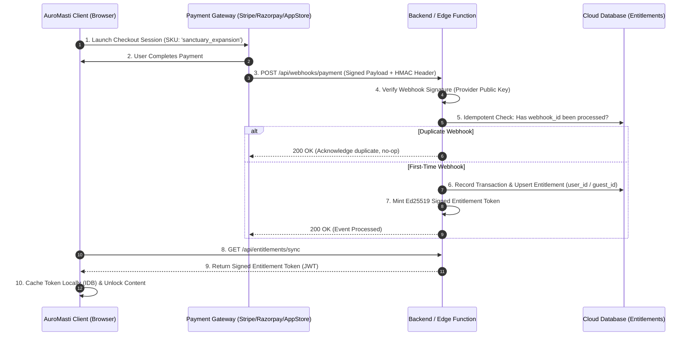

# AuroMasti B18-B1 — Purchase & Entitlement Security Specification
## Provider-Independent Commerce Architecture, Cryptographic Verification, and Offline Security (ADR-08)

- **Document Version:** 1.0.0
- **Batch Reference:** B18-B1 Final ADR Clarification & Approval Preparation
- **Canonical Workspace:** `C:\AuroMindPortal`
- **Target Release:** January 1, 2027
- **Commercial Gate State:** `COMMERCIAL_GATE_ENABLED: false` (100% Free Launch)
- **Governance Status:** PENDING OWNER APPROVAL

---

## 1. Architectural Philosophy & Dual-State Design

The Product Owner has mandated that **the entire purchase and entitlement engine must be architected, implemented, and validated during development**, even though commercial paywalls will remain strictly disabled for the January 1, 2027 launch.

### Dual-State Operating Model:
- **State A: Free Launch Mode (`COMMERCIAL_GATE_ENABLED: false`):** All 520 AuroMatch levels, 1,368 VAK speech training levels, 36 catalogue games, and contemplative modes are 100% free and open. The entitlement subsystem bypasses paywalls and returns unconditional access for all standard SKUs.
- **State B: Activated Commerce Mode (`COMMERCIAL_GATE_ENABLED: true`):** Entitlement gates activate seamlessly without requiring architectural redesign or game code modifications. Access to premium expansions or supporter passes is governed by cryptographically signed, server-verified tokens.

---

## 2. Server-Side Transaction Verification & Webhook Architecture

To eliminate reliance on client-reported transactions (which are vulnerable to tampering and local script spoofing), all purchases are verified strictly server-side:



### 2.1 Webhook Idempotency & Replay Protection
- Every webhook payload contains a provider-assigned `event_id`.
- The backend records `event_id` inside an idempotent PostgreSQL table `processed_webhook_events` with a primary key constraint. Duplicate webhook deliveries receive HTTP 200 immediately without re-crediting or re-minting.

### 2.2 Refunds & Chargeback Revocation
- When a refund or dispute occurs, the payment gateway dispatches a `charge.refunded` or `dispute.created` webhook.
- The server sets `status = 'REVOKED'` in the `entitlements` table and appends the token's unique ID (`jti`) to a Revoked Token Cache.
- On next client sync, the SDK updates its cached tokens, revoking premium feature access gracefully.
- **Sacred Data Guarantee:** User-created assets (e.g., mandalas colored with a premium palette) are **never deleted or hidden**. The player simply cannot select the premium palette for future canvases.

---

## 3. Cryptographic Entitlement Token Security

### 3.1 Ed25519 Signed Entitlement Token Structure
Entitlements are issued as compact JWTs digitally signed using **Ed25519 (Edwards-curve Digital Signature Algorithm)**, which provides high security with small key sizes (32-byte public keys) and fast browser verification:

```typescript
export interface EntitlementTokenPayload {
  iss: 'https://api.auromind.org'; // Issuer
  sub: string;                      // User ID or linked Guest ID (UUIDv4)
  aud: 'auromind_game_platform';   // Audience
  jti: string;                      // Unique Token Nonce (UUIDv4)
  iat: number;                      // Issued-at Unix Epoch (seconds)
  nbf: number;                      // Not-before Unix Epoch (seconds)
  exp: number;                      // Token expiration Unix Epoch (seconds)
  sku: string;                      // E.g., 'supporter_pass_2027', 'sanctuary_pack'
  tier: 'LIFETIME' | 'SEASONAL' | 'SUBSCRIPTION';
  kid: string;                      // Key ID used for rotation
}
```

### 3.2 Key Management & Rotation Protocol
- **Private Key Storage:** The private signing key resides strictly within a secure Cloud Key Management Service (KMS / HSM). It is **never** checked into Git or exposed to Edge Function logs.
- **Public Key Distribution:** Public verification keys are published via a standard JSON Web Key Set (`/.well-known/jwks.json`).
- **Key Rotation (`kid`):**
  - Tokens declare `kid: "key_2026_v1"`.
  - When keys are rotated annually, new tokens use `"key_2027_v1"`.
  - The client SDK fetches and caches active public keys in IndexedDB, checking for new keys if an unrecognized `kid` is encountered.
- **Compromised-Key Recovery:** If a private key is compromised, an emergency key revocation list (`revoked_keys.json`) is published. The SDK checks this list during online sync and discards tokens signed by compromised keys.

---

## 4. Offline Entitlement Behavior & Security Boundaries

### 4.1 Recommendation: 30-Day Offline Grace Period
> [!IMPORTANT]
> **Owner Decision Required:** The 30-day offline grace period is presented as a **technical recommendation**, subject to Product Owner approval.

- **Proposed Rule:** A locally cached, validly signed entitlement token grants access to purchased content while offline for up to **30 consecutive days** from the last verified online sync timestamp (`lastOnlineSyncAt`).
- **Grace Period Expiration:** If the device remains completely offline for $> 30$ days, premium content locks non-destructively with a gentle notification: *"Please connect to the internet briefly to refresh your offline access pass."*

### 4.2 Realistic Browser Security Boundaries (Clock Manipulation Defense)
A fundamental tenet of client-side architecture is that **a browser running on a user's machine cannot provide absolute hardware-level security**. A knowledgeable user with Developer Tools or root operating system access can manipulate local JavaScript variables, mock API calls, or adjust system clocks.

#### Security Clarification (Best-Effort vs. Absolute Guarantees):
1. **What Browser Protections CAN Do (Anti-Tamper Friction):**
   - The SDK maintains **monotonic timestamp anchors** in save envelopes and compares them against `Date.now()`. If `Date.now()` is older than the latest save envelope timestamp, a `CLOCK_ROLLBACK_DETECTED` warning is logged, and the offline grace period is computed from monotonic elapsed time (`performance.now()`).
   - The Root Service Worker captures the `Date` HTTP response header from network requests to cross-check system clock drift.
   - These defenses defeat casual piracy and accidental system clock changes.
2. **What Browser Protections CANNOT Do (Physical Reality):**
   - Client-side checks alone **cannot** physically prevent an attacker with full debugger control from altering code in RAM.
   - **True Security Guarantee:** Irreversible cloud saves, leaderboard progression, cross-device sync, and multiplayer validation remain strictly guarded on the server via verified Ed25519 signatures.

### 4.3 Reinstall & Multi-Device Restoration
When a player installs AuroMasti on a new device or clears browser storage:
1. The player clicks *"Restore Purchases"* in Portal Settings.
2. If authenticated via email or linked account, the server returns all active signed entitlement tokens.
3. If playing as an anonymous guest, the player enters their private **Recovery Key** (minted during guest creation), restoring their linked entitlements.

---

## 5. Provider-Independent SDK Interface & Mock Engine

The shared SDK interacts with purchases via a decoupled provider contract (`sdk.purchases`):

```javascript
/**
 * AuroMind Purchases Service Interface
 */
class AuroMindPurchasesService {
  /**
   * Initializes purchase engine with configured provider adapter.
   */
  async init(providerAdapter);

  /**
   * Requests purchase of a specific SKU.
   * In Free Launch mode, immediately unlocks with zero transaction.
   * @param {string} sku
   * @returns {Promise<{ success: boolean, token?: string, error?: string }>}
   */
  async requestPurchase(sku);

  /**
   * Checks whether the current player possesses a valid entitlement for a SKU.
   * Respects COMMERCIAL_GATE_ENABLED flag.
   * @param {string} sku
   * @returns {boolean}
   */
  hasEntitlement(sku);

  /**
   * Restores previously purchased entitlements from cloud backend.
   * @returns {Promise<{ restoredCount: number, tokens: string[] }>}
   */
  async restorePurchases();
}
```

### Testable Mock Provider (`MockPurchaseProvider`)
To enable full automated unit, integration, and E2E testing without incurring real financial transactions or requiring live gateway credentials:
- A `MockPurchaseProvider` simulates checkout dialogs, successful purchases, card declines, refunds, and token issuance in automated test environments.
- Tests verify entitlement unlocking, offline grace enforcement, and revocation handling with 100% test reproducibility.
