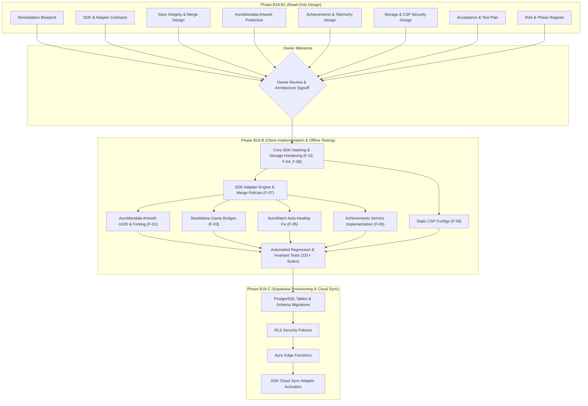

# AuroMasti B18-B1 — Risk, Dependency & Phase Allocation Register
## Comprehensive Architectural Roadmap, Sequencing, and Governance Matrix

- **Document Version:** 1.0.0
- **Batch Reference:** AuroMasti B18-B1 (Read-Only Architecture & Blueprint)
- **Target Branch:** `dev/studio-integration`
- **Canonical Workspace:** `C:\AuroMindPortal`
- **Target Release:** January 1, 2027
- **Findings Addressed:** All Findings F-01 through F-09
- **ADR Governance Status:** All 10 Architecture Decision Records remain **PENDING OWNER APPROVAL**

---

## 1. Executive Summary & Governance Scope

The AuroMasti shared services transition is a high-stakes architectural evolution from an isolated offline minigame collection to a unified, resilient, cloud-ready web gaming platform. To safeguard gameplay integrity, prevent regressions, and eliminate data loss risks, all engineering activities are strictly phased across distinct boundaries:
- **Phase B18-B1 (Current Batch):** Comprehensive read-only audit, architectural modeling, contract specifications, and test plan definitions. Zero application source modifications.
- **Phase B18-B (Next Batch):** Client-side SDK and game adapter remediation, offline persistence hardening, and local-first automated test suite execution (231 current tests + new test suites). 100% offline.
- **Phase B18-C (Subsequent Batch):** Supabase project provisioning, PostgreSQL database schema migrations, Row-Level Security (RLS) policies, Edge Functions, and cloud backup activation.
- **Deferred Post-B18:** Payment gateway webhooks, external federated OAuth providers, cross-origin shared workers, and real-time multiplayer lobbies.

---

## 2. Complete Phase Allocation Matrix

| Work Item / Remediation Task | Target Finding / Feature | Phase | Rationale & Boundaries |
| :--- | :--- | :--- | :--- |
| **Comprehensive Architecture Blueprint & Contracts** | F-01 through F-09 | **B18-B1** | Strict read-only architectural design and specification. Completed in this batch. |
| **AuroMandala Artwork Versioning & Forking Model** | F-01 | **B18-B** | Client-side save schema migration in `auromandala-sdk-bridge.js`. Zero cloud dependency. |
| **Canonical JSON & Cryptographic SHA-256 Checksums** | F-02 | **B18-B** | Standardized hashing across all 6 game bridges using Web Crypto `crypto.subtle`. |
| **Standalone Bridges (VAK, Word Riddle, Sanctuary)** | F-03 | **B18-B** | Implementation of modular SDK bridge files in `games/*/assets/`. |
| **Storage Resilience (`navigator.storage.persist`)** | F-04 | **B18-B** | Browser persistence and quota monitoring in `auromind-sdk.js`. |
| **AuroMatch Auto-Healing & Corruption Recovery** | F-05 | **B18-B** | Refactoring of `storageAdapter.js` to ensure resilient dual-storage reconciliation. |
| **Shared SDK Achievements Service (`sdk.achievements`)** | F-06 | **B18-B** | Local offline achievement state management, idempotent unlocks, and monotonic union. |
| **Bespoke Domain Merge Policies** | F-07 | **B18-B** | Game-specific conflict resolution rules implemented in `auromind-adapters.js`. |
| **3-Tier Priority Telemetry Queue & Privacy Gate** | F-08 | **B18-B** | Local bounded queue (500 events) and sanitization filter excluding Sankalpa Vault. |
| **Static Hosting Security Headers (Vercel, CF, Netlify)** | F-09 | **B18-B** | Creation of `vercel.json`, `_headers`, and `netlify.toml` matching `server.js` CSP. |
| **Comprehensive Automated Offline Test Suites** | All F-01–F-09 | **B18-B** | Execution of Level 1–5 test suites verifying 0 regressions in air-gapped environment. |
| **Supabase Project Provisioning & Config** | Cloud Backend | **B18-C** | Creation of cloud project, service role secrets, and client URL configuration. |
| **PostgreSQL Schema Migrations (`001_initial_schema`)** | Cloud Tables | **B18-C** | Table definitions: `players`, `game_saves`, `achievements`, `telemetry_events`. |
| **Row-Level Security (RLS) Policies** | Cloud Security | **B18-C** | Strict tenant isolation ensuring players can only read/write their own envelopes. |
| **Cloud Synchronization Edge Functions** | Cloud Sync | **B18-C** | Idempotent sync endpoints executing monotonic version checks and validation. |
| **Payment Gateway Webhook Activation (Stripe/Razorpay)** | Entitlements | **Deferred** | Requires business entity establishment and PCI-DSS compliance signoff. |
| **External OAuth Identity Providers (Google, Apple)** | Identity | **Deferred** | Single browser profile = single identity rule remains active. External OAuth deferred. |
| **Cross-Origin Shared Workers / Real-Time Lobbies** | Multiplayer | **Deferred** | Local-first single-player focus takes precedence for January 1, 2027 release. |

---

## 3. Topological Dependency Graph & Execution Sequencing



---

## 4. Architectural Risk Register & Mitigation Strategies

| Risk ID | Severity | Category | Risk Description | Probability | Mitigation Strategy |
| :--- | :--- | :--- | :--- | :--- | :--- |
| **R-01** | **HIGH** | Data Loss | Artwork corruption or loss during AuroMandala schema migration to UUIDv4. | Low | Dual-read fallback: Read legacy array format, convert to map on first write, and archive unmigrated backup to `localStorage.pranamandala_legacy_backup`. |
| **R-02** | **HIGH** | Regression | New SDK adapter bridges breaking standalone execution in legacy iframes. | Medium | Preserve standalone mock fallbacks inside bridges (`window.AuroMindSDK || LocalMock`). |
| **R-03** | **MEDIUM** | Storage Quota | Browser denies `navigator.storage.persist()` (e.g. user in private/incognito mode). | High | Graceful degradation: Log diagnostic warning, maintain IndexedDB + localStorage caching, inform user in portal UI. |
| **R-04** | **CRITICAL** | Sacred Data | Inadvertent modification of VAK corpus or Flora database during batch execution. | Low | Mandatory preflight and postflight SHA-256 byte verification gates in test suites. Zero touch rule enforced. |
| **R-05** | **MEDIUM** | Performance | SHA-256 checksum computation on large saves (AuroMandala) causing main thread frame drops. | Medium | Asynchronous Web Crypto API (`crypto.subtle.digest`) executed during idle frames (`requestIdleCallback`) or debounced save intervals. |
| **R-06** | **HIGH** | Privacy | Telemetry logging private user prayers or spiritual vows from Sankalpa Vault. | Low | Hard architectural boundary: `cloudSyncEligible: false`, blacklisted keys in telemetry sanitizer, local-only AES-GCM encryption. |

---

## 5. Rollback Strategies & Feature-Flag Boundaries

To guarantee that any unexpected defect during Phase B18-B can be isolated or reverted without destabilizing the platform:

### 5.1 Architecture Feature Flag Matrix (`backend-config.js`)
```javascript
export const FEATURE_FLAGS = {
  // B18-B Client Feature Flags (Defaulting to enabled in B18-B):
  ENABLE_CRYPTO_CHECKSUM: true,       // Falls back to string hash if Web Crypto unavailable
  ENABLE_STORAGE_PERSISTENCE: true,   // Gracefully skips if navigator.storage unsupported
  ENABLE_ROBUST_AUTOHEAL: true,       // Falls back to legacy recovery if false
  ENABLE_ACHIEVEMENTS_SERVICE: true,  // Idempotent local achievements
  ENABLE_PRIORITIZED_TELEMETRY: true, // 3-tier queue with privacy filter

  // B18-C Cloud Feature Flags (STRICTLY DISABLED in B18-B):
  ENABLE_CLOUD_SYNC: false,           // 100% offline local-first mode
  ENABLE_SUPABASE_AUTH: false,        // Anonymous guest profile mode
  ENABLE_REMOTE_ACHIEVEMENTS: false   // Local achievements only
};
```

### 5.2 Rollback Procedure
If any game adapter bridge causes an unexpected failure during B18-B testing:
1. **Targeted Bridge Rollback:** Revert only the specific game bridge (e.g., `git checkout HEAD -- games/auromandala/assets/auromandala-sdk-bridge.js`).
2. **Save Data Isolation:** Legacy save keys (`pranamandala_game_cache_v2`, `auro_match_user`, `vak_game_data`) are never renamed or deleted; the new bridges act strictly as adapters over existing keys.
3. **No Database State to Roll Back:** Because Phase B18-B introduces zero cloud migrations or backend dependencies, rollback is strictly a local git file operation with zero risk to remote databases.

---

## 6. Architecture Decision Record (ADR) Status Matrix

All ten ADRs originally formulated in B18-A and evaluated in B18-A2 / B18-A3 remain **PENDING OWNER APPROVAL**. Phase B18-B implementation will strictly adhere to the approved decisions once confirmed by the product owner.

| ADR ID | Architecture Decision Title | Proposed Decision | Current Status | Impact on B18-B Client Code |
| :--- | :--- | :--- | :--- | :--- |
| **ADR-01** | Canonical Identity Model | Anonymous Guest ID with Local Key (One Profile = One Player) | **PENDING OWNER APPROVAL** | `auromind-sdk.js` maintains persistent anonymous guest UUID in local storage. |
| **ADR-02** | Local-First Storage Architecture | Dual Storage (IndexedDB Primary + LocalStorage Cache) | **PENDING OWNER APPROVAL** | Hardens `storageAdapter.js` and SDK storage fallback. |
| **ADR-03** | Save Envelope & Revision Framing | Standardized Envelope with Monotonic Revisions | **PENDING OWNER APPROVAL** | Normalizes save envelopes across all 6 games. |
| **ADR-04** | Conflict Resolution Strategy | Domain-Specific Monotonic Merge + Fork on Artwork Conflict | **PENDING OWNER APPROVAL** | Implements non-destructive merge logic in `auromind-adapters.js`. |
| **ADR-05** | Cryptographic Checksum Engine | Canonical JSON + Web Crypto SHA-256 | **PENDING OWNER APPROVAL** | Replaces fragile string concatenation in bridges. |
| **ADR-06** | Shared SDK Adapter Interface | Standardized Native ES Module Adapter Bridges | **PENDING OWNER APPROVAL** | Bridges implemented for VAK, Word Riddle, Sanctuary. |
| **ADR-07** | Storage Resilience & Eviction | Explicit `navigator.storage.persist()` Registration | **PENDING OWNER APPROVAL** | Protects data against Safari 7-day ITP and Blink LRU wipe. |
| **ADR-08** | Offline Achievements Architecture | Monotonic Local Store with Monotonic Union Sync | **PENDING OWNER APPROVAL** | Formalizes `sdk.achievements` service. |
| **ADR-09** | Telemetry Prioritization & Privacy | 3-Tier Priority Queue + Sacred Data Sanitizer | **PENDING OWNER APPROVAL** | Eliminates memory overflow and protects Sankalpa Vault. |
| **ADR-10** | Production CSP & Hosting Sync | Unified Multi-Host CSP (`server.js`, Vercel, CF, Netlify) | **PENDING OWNER APPROVAL** | Prevents clickjacking and script injection. |

---

## 7. Next Actions & Owner Decision Gate

1. **Owner Review of Deliverables 1–8:** The product owner reviews the comprehensive B18-B1 architecture blueprint and contract designs.
2. **Formal Architecture Signoff:** The owner approves the 10 ADRs and authorizes Phase B18-B client implementation.
3. **Execution of B18-B:** Implementation of client code remediation, adapter bridges, storage hardening, and execution of the complete 231+ automated regression test suite.
