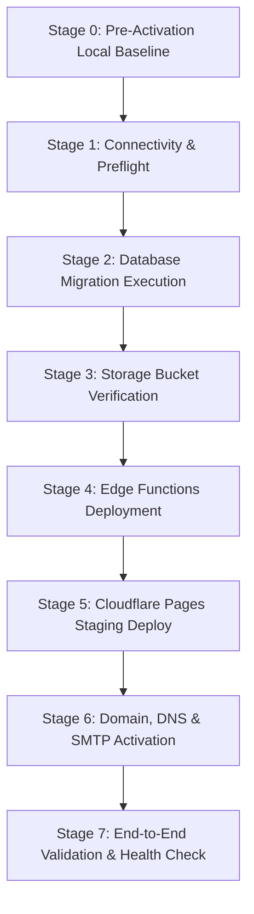

# AuroMasti — B19.7 Cloud Activation Runbook

**Target Project:** `AuroMasti` (`rlqrtbjynaihdspbqtce`)  
**Region:** `ap-southeast-1`  
**Execution Phase:** B19.8 Remote Activation (Planned for November 28, 2026)  
**Execution Environment:** Windows PowerShell / agy-node  
**Canonical Workspace:** `C:\AuroMindPortal`  
**Branch:** `dev/studio-integration`  
**Target Release:** January 1, 2027 — Version 2.0.0 Beta  

---

## 1. Overview & Operational Principles

This Runbook defines the deterministic sequence of operations to activate AuroMasti cloud infrastructure once reliable network connectivity (IPv6 or IPv4 with pooling) is available.

### Core Principles:
1. **Safety First:** Every stage begins with verification and dry-run preflight.
2. **Zero Surprises:** Expected outputs and failure signatures are documented for every step.
3. **Idempotence:** Every operation can be safely retried without duplicating objects or corrupting state.
4. **Least Privilege:** Public clients use `SUPABASE_PUBLISHABLE_KEY`; migrations use `SUPABASE_ACCESS_TOKEN` and `SUPABASE_DB_PASSWORD`. `service_role` is never exposed in client bundles.
5. **Fail-Closed Gate:** If any preflight check fails, stop immediately. Do not force or bypass checks.

---

## 2. Stage-by-Stage Activation Sequence



---

### Stage 0 — Pre-Activation Local Baseline Verification

Ensure the local repository is clean, healthy, and all invariants match before attempting any network operations.

1. **Confirm Working Directory & Branch:**
   ```powershell
   cd C:\AuroMindPortal
   git status
   git log -1 --oneline
   ```
   *Expected Output:* On branch `dev/studio-integration`, working tree clean for tracked files.

2. **Verify Sacred Invariants & Health Status:**
   ```powershell
   node scripts/health-check.mjs
   ```
   *Expected Output:* `Overall Health Status: HEALTHY` (All 4 invariants PASS).

3. **Verify Local CLI Availability:**
   ```powershell
   npx supabase --version
   ```
   *Expected Output:* `3.4.0`

---

### Stage 1 — Network & Credential Preflight

Verify network reachability and local credential configuration without performing any mutations.

1. **Verify Local Credentials:**
   ```powershell
   node scripts/validate-env.mjs
   ```
   *Expected Output:* `Result: PASSED` (13 passed, 0 errors, 0 warnings).

2. **Verify IPv6 / Database Connectivity:**
   ```powershell
   Test-NetConnection -ComputerName db.rlqrtbjynaihdspbqtce.supabase.co -Port 5432
   ```
   *Success Indicator:* `TcpTestSucceeded : True`.  
   *Contingency if False:* If direct port 5432 is unreachable over IPv6, test the IPv4 connection pooler:
   ```powershell
   Test-NetConnection -ComputerName aws-0-ap-southeast-1.pooler.supabase.com -Port 6543
   ```

3. **Execute Non-Mutating Remote Preflight:**
   ```powershell
   node scripts/migration-workflow.mjs --preflight
   ```
   *Expected Output:*
   - CLI & Runtime: Supabase CLI AVAILABLE (v3.4.0 via npx supabase).
   - Target project: `rlqrtbjynaihdspbqtce` (VALID).
   - Preflight State: `CLEAN_INITIAL_STATE` (if initial run) or `MIGRATIONS_PENDING`.

---

### Stage 2 — Database Migration Execution

Apply the 10 canonical migrations sequentially via the Supabase CLI.

> [!IMPORTANT]
> **Product Owner Authorization Required:** Ensure formal authorization has been granted before proceeding with Stage 2.

1. **Execute Dry-Run Migration Verification:**
   ```powershell
   npx supabase db push --dry-run
   ```
   *Verify:* Output lists pending migrations without syntax errors.

2. **Execute Database Migration:**
   ```powershell
   npx supabase db push
   ```
   *Expected Result:*
   All 10 migrations applied in chronological sequence:
   - `20261120000001_b5_core_schema.sql`
   - `20261120000002_b8_rate_limiting.sql`
   - `20261120000003_b13a_telemetry_rls_hardening.sql`
   - `20261120000004_b13b_telemetry_retention.sql`
   - `20261122000001_b18c_profile_rls_separation.sql`
   - `20261122000002_b18c_telemetry_token_bucket.sql`
   - `20261122000003_b18c_telemetry_search_path_hardening.sql`
   - `20261122000004_b18d_telemetry_token_bucket_input_validation.sql`
   - `20261123000001_b19_5_05_db_integrity_and_rls_hardening.sql`
   - `20261123000002_b19_5_06_storage_buckets_and_rls.sql`

3. **Alternative Dashboard Execution (Fallback):**
   If CLI direct database connection fails due to network routing restrictions:
   ```powershell
   node scripts/migration-workflow.mjs --bundle
   ```
   Copy the generated `supabase/consolidated_migration_preview.sql` and execute it in the Supabase Dashboard SQL Editor (`https://supabase.com/dashboard/project/rlqrtbjynaihdspbqtce/sql`).

4. **Verify Remote Schema Integrity:**
   Generate the verification script:
   ```powershell
   node scripts/migration-workflow.mjs --verify-sql
   ```
   Execute `supabase/verify_remote_schema.sql` against the remote database.  
   *Expected Output:* `SUCCESS: All 14 public tables verified with RLS enabled and hardened function search_paths.`

---

### Stage 3 — Supabase Storage Verification

Verify private storage buckets and owner-folder RLS policies on the remote project.

1. **Verify Buckets in Supabase Dashboard:**
   Navigate to **Storage** in the Supabase Dashboard:
   - `avatars`: Private, file size limit `512 KiB`, allowed MIME types `image/png`, `image/jpeg`, `image/webp`.
   - `user-artwork`: Private, file size limit `5 MiB`, allowed MIME types `image/png`, `image/webp`, `application/json`.

2. **Verify Storage RLS Policies:**
   In **Storage > Policies**, verify that policies exist for:
   - `avatars_owner_select`, `avatars_owner_insert`, `avatars_owner_update`, `avatars_owner_delete`
   - `artwork_owner_select`, `artwork_owner_insert`, `artwork_owner_update`, `artwork_owner_delete`
   - Zero anonymous access policies.

---

### Stage 4 — Supabase Edge Functions Deployment

Deploy all 6 canonical Edge Functions to the remote project.

1. **Deploy Functions:**
   ```powershell
   npx supabase functions deploy sync-save
   npx supabase functions deploy ingest-telemetry
   npx supabase functions deploy cleanup-telemetry
   npx supabase functions deploy delete-account
   npx supabase functions deploy owner-metrics
   npx supabase functions deploy verify-entitlements
   ```

2. **Configure Edge Function Secrets (if required by custom environment):**
   ```powershell
   npx supabase secrets set COMMERCIAL_GATE_ENABLED=false
   ```

3. **Verify Function Health via HTTP OPTIONS:**
   ```powershell
   curl -I -X OPTIONS https://rlqrtbjynaihdspbqtce.supabase.co/functions/v1/ingest-telemetry
   ```
   *Expected Status:* HTTP 200 with `Access-Control-Allow-Origin: *`.

---

### Stage 5 — Cloudflare Pages Staging Deployment

Deploy the static portal and launch games to Cloudflare Pages staging.

1. **Validate Cloudflare Configuration:**
   ```powershell
   node scripts/validate-cloudflare-config.mjs
   ```
   *Expected Output:* `Result: PASSED` (All 11 checks pass).

2. **Execute Static Build:**
   ```powershell
   npm run build
   ```

3. **Deploy to Cloudflare Pages (via Wrangler or Cloudflare Dashboard Git integration):**
   - Project: `auromasti`
   - Branch: `dev/studio-integration`
   - Build command: `npm run build`
   - Output directory: `.`
   - Target URL: `https://staging.auromasti.pages.dev`

4. **Verify Headers & Asset Routing:**
   Curl the staging URL to verify headers:
   ```powershell
   curl -I https://staging.auromasti.pages.dev
   ```
   *Confirm:* `X-Frame-Options: SAMEORIGIN`, `Content-Security-Policy`, `Strict-Transport-Security`.

---

### Stage 6 — Domain, DNS & SMTP Activation

Configure production domains and transactional email.

1. **DNS Cutover for `auromasti.com`:**
   - Add CNAME flattening record in Cloudflare DNS:
     - `auromasti.com` $\rightarrow$ `auromasti.pages.dev`
     - `www.auromasti.com` $\rightarrow$ `auromasti.pages.dev`
   - SSL/TLS encryption mode: **Full (Strict)**.

2. **SMTP Setup in Supabase Dashboard (Auth > Settings > Email):**
   - Enable Custom SMTP.
   - Host: `smtp.resend.com` (or configured provider).
   - Port: `587`.
   - Sender Email: `noreply@auromasti.com`.
   - Sender Name: `AuroMasti Sanctuary`.
   - Verify DNS records at domain registrar:
     - SPF: `v=spf1 include:... ~all`
     - DKIM: CNAME records as provided by SMTP service.
     - DMARC: `v=DMARC1; p=reject; rua=mailto:dmarc@auromasti.com; pct=100`

---

### Stage 7 — End-to-End Validation & Verification Drill

Perform final live smoke test on `https://staging.auromasti.pages.dev`.

1. **Load Portal:** Confirm 3 launch games display properly with zero console errors.
2. **Launch Game Theater:** Launch each of the 3 games (`auromandala`, `auromatch`, `auroblocks`), play 1 minute, and exit cleanly.
3. **Verify Guest Identity & Save:** Confirm save data persists locally in IndexedDB/LocalStorage.
4. **Verify Telemetry Ingest:** Confirm privacy-sanitized telemetry events are received at Edge Function.
5. **Verify Zero Commerce:** Confirm no payment prompts appear; all features accessible.

---

## 3. Rollback & Contingency Procedures

| Failure Scenario | Mitigation / Rollback Action |
| :--- | :--- |
| **Direct IPv6 unreachable** | Switch Supabase CLI or application connection to IPv4 Connection Pooler (`aws-0-ap-southeast-1.pooler.supabase.com:6543`). |
| **Migration syntax / lock error** | Database migrations run in transactions; failed migrations roll back automatically. Review error log, fix SQL, re-run `npx supabase db push`. |
| **Edge Function deploy failure** | Previous function version remains active in Supabase Edge Runtime. Inspect function log: `npx supabase functions logs <name>`. |
| **Staging build regression** | Rollback static bundle using `node -e "import('./scripts/deployment-automation.mjs').then(m => m.rollbackRelease())"`. |
| **DNS propagation delay** | Keep TTL at 300s during transition. Staging domain (`staging.auromasti.pages.dev`) remains operational throughout. |
