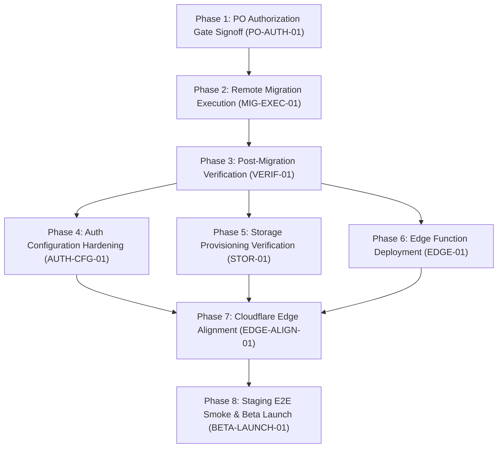

# AuroMasti — B19.9.1 Supabase Remediation & Release Activation Backlog

**Document ID:** `B19-9-1-SUPABASE-REMEDIATION-BACKLOG`  
**Milestone:** B19.9.1  
**Target Release:** Version 2.0.0 Beta  
**Target Launch Deadline:** November 30, 2026  
**Auditor:** Principal Software Architect & Release Acceptance Lead  
**Canonical Workspace:** `C:\AuroMindPortal`  
**Branch:** `dev/studio-integration`  
**Baseline Git Commit:** [`36250db9b33d954c746464531bb8b7f80e45cc01`](file:///C:/AuroMindPortal)  
**Execution Policy:** STRICT READ-ONLY PREFLIGHT AUDIT COMPLETE — ZERO REMOTE MUTATIONS

---

## 1. Backlog Overview & Dependency Roadmap

This backlog establishes the precise, dependency-ordered engineering and operational action items required to progress from the B19.9.1 read-only audit baseline to full live production deployment on November 30, 2026.

---

## 2. Dependency-Ordered Work Packages

### Phase 1: Product Owner Authorization & Gate Clearance
*Mandatory Precondition: Zero remote mutations may be executed without explicit, attributable Product Owner approval.*

| Task ID | Component | Task Description | Acceptance Criteria | Priority | Dependencies |
| :--- | :--- | :--- | :--- | :---: | :---: |
| **PO-AUTH-01** | Governance | Present B19.9.1 Readiness Report and obtain attributable Product Owner signature. | Attributable JSON approval record generated in `supabase/authorization_audit.log` matching manifest hash `f55231159389f9d5...`. | **P0** | None |
| **PO-AUTH-02** | Safety | Verify Point-in-Time Recovery (PITR) backup readiness in Supabase project `rlqrtbjynaihdspbqtce`. | Supabase Dashboard confirms active continuous WAL archiving and automated daily snapshot. | **P0** | PO-AUTH-01 |

---

### Phase 2: Controlled Migration Execution over Session Pooler
*Target Endpoint: `aws-1-ap-southeast-1.pooler.supabase.com:5432`*

| Task ID | Component | Task Description | Acceptance Criteria | Priority | Dependencies |
| :--- | :--- | :--- | :--- | :---: | :---: |
| **MIG-EXEC-01** | Database DDL | Execute the 10 canonical migrations using `executeRemoteMigrations()` with Session Pooler targeting. | All 10 migrations executed in lexical order; `supabase_migrations.schema_migrations` records 10 applied versions; zero execution errors. | **P0** | PO-AUTH-01, PO-AUTH-02 |
| **MIG-EXEC-02** | Credential Guard | Audit execution process environment to confirm zero plaintext passwords leaked to logs or process table. | Execution audit log confirms masked secrets (`[REDACTED]`); Win32_Process contains zero password strings. | **P0** | MIG-EXEC-01 |

---

### Phase 3: Post-Migration Affirmative Catalog & RLS Verification

| Task ID | Component | Task Description | Acceptance Criteria | Priority | Dependencies |
| :--- | :--- | :--- | :--- | :---: | :---: |
| **VERIF-01** | Schema DDL | Execute `supabase/verify_remote_schema.sql` against the Session Pooler. | Read-only verification query confirms all 15 public tables exist, 100% RLS enabled, and zero unpinned search paths. | **P0** | MIG-EXEC-01 |
| **VERIF-02** | REST Cache | Query PostgREST OpenAPI schema (`GET /rest/v1/`) with service role key to confirm schema reload. | PostgREST schema cache reflects all 15 public tables; previous `PGRST205` errors cleared for valid tables. | **P1** | VERIF-01 |

---

### Phase 4: Supabase Auth Configuration Hardening

| Task ID | Component | Task Description | Acceptance Criteria | Priority | Dependencies |
| :--- | :--- | :--- | :--- | :---: | :---: |
| **AUTH-CFG-01** | GoTrue Auth | Update Site URL and Additional Redirect URLs in Supabase Dashboard. | Site URL set to `https://auromasti.com`; redirect URLs include `https://staging.auromasti.pages.dev/**` and `http://localhost:3000/**`. | **P1** | MIG-EXEC-01 |
| **AUTH-CFG-02** | Guest Identity | Evaluate enabling anonymous sign-ins (`external.anonymous_users = true`) in Dashboard. | GoTrue `/auth/v1/settings` returns `external.anonymous_users: true` or affirmative offline guest-to-email flow confirmed. | **P2** | AUTH-CFG-01 |
| **AUTH-CFG-03** | Auth Templates | Review and customize verification email templates and sender name ("AuroMasti"). | Email verification links point to canonical HTTPS domain with PKCE code challenge. | **P2** | AUTH-CFG-01 |

---

### Phase 5: Storage Provisioning Verification

| Task ID | Component | Task Description | Acceptance Criteria | Priority | Dependencies |
| :--- | :--- | :--- | :--- | :---: | :---: |
| **STOR-01** | Supabase Storage | Verify `avatars` bucket configuration and RLS policies. | Bucket `avatars` is public, max 2MB, allowed types PNG/JPEG/WEBP; authenticated users restricted to own folder. | **P1** | MIG-EXEC-01 |
| **STOR-02** | Supabase Storage | Verify `user-artwork` bucket configuration and RLS policies. | Bucket `user-artwork` is private, max 5MB, allowed types PNG/JPEG/WEBP; owner-only read/write enforced. | **P1** | MIG-EXEC-01 |
| **STOR-03** | Local Invariant | Confirm AuroMandala client-side storage default remains IndexedDB-only. | Zero automatic uploads on artwork creation; upload occurs only on explicit user cloud save. | **P0** | STOR-02 |

---

### Phase 6: Edge Functions Deployment & Scheduling

| Task ID | Component | Task Description | Acceptance Criteria | Priority | Dependencies |
| :--- | :--- | :--- | :--- | :---: | :---: |
| **EDGE-01** | Edge Runtime | Deploy `cleanup-telemetry` function to Supabase project `rlqrtbjynaihdspbqtce`. | Function deployed and visible in Supabase Dashboard; healthy status reported. | **P2** | MIG-EXEC-01 |
| **EDGE-02** | Cron Scheduler | Configure cron trigger or pg_cron schedule for daily telemetry cleanup. | Telemetry records older than 30 days automatically purged by `public.purge_expired_telemetry_events()`. | **P2** | EDGE-01 |

---

### Phase 7: Cloudflare Edge Alignment & Environment Promotion

| Task ID | Component | Task Description | Acceptance Criteria | Priority | Dependencies |
| :--- | :--- | :--- | :--- | :---: | :---: |
| **EDGE-ALIGN-01** | Cloudflare Pages | Configure production environment variables on Cloudflare Pages (`auromasti`). | `NEXT_PUBLIC_SUPABASE_URL` and `NEXT_PUBLIC_SUPABASE_ANON_KEY` configured in Cloudflare Pages dashboard. | **P1** | AUTH-CFG-01 |
| **EDGE-ALIGN-02** | CSP Security | Verify Content Security Policy headers allow Supabase REST/WSS connections from Cloudflare edge. | Browser console reports 0 CSP violation reports when authenticating and syncing state. | **P1** | EDGE-ALIGN-01 |
| **EDGE-ALIGN-03** | Gate Invariant | Confirm `COMMERCIAL_GATE_ENABLED=false` is enforced on Cloudflare production build. | Portal loads with launch catalogue (3 games), zero payment UI, zero commercial gateways. | **P0** | EDGE-ALIGN-01 |

---

### Phase 8: Staging E2E Smoke & Beta Launch Clearance

| Task ID | Component | Task Description | Acceptance Criteria | Priority | Dependencies |
| :--- | :--- | :--- | :--- | :---: | :---: |
| **BETA-LAUNCH-01** | Live QA | Execute end-to-end user journey on staging (`https://staging.auromasti.pages.dev`). | Guest play, email signup, email verification, cloud save sync, theater exit, and gallery viewing all succeed. | **P0** | All previous phases |
| **BETA-LAUNCH-02** | Crypto Audit | Verify Sankalpa Vault client-side encryption on staging. | Zero Sankalpa payloads appear in network inspector; vault unlocked via PBKDF2 passphrase. | **P0** | BETA-LAUNCH-01 |
| **BETA-LAUNCH-03** | Final Acceptance | Product Owner and Engineering Lead sign off on Beta Release 2.0.0. | Final release tag `v2.0.0-beta` cut from `dev/studio-integration` and promoted to `main`. | **P0** | BETA-LAUNCH-02 |

---

## 3. Immediate Next Steps (Chronological Sequence)

1. **Review and Deliver:** Present [`docs/reports/B19_9_1_COMPREHENSIVE_SUPABASE_READINESS_REPORT.md`](file:///C:/AuroMindPortal/docs/reports/B19_9_1_COMPREHENSIVE_SUPABASE_READINESS_REPORT.md) and this backlog to the Product Owner.
2. **Obtain Gate Approval:** Secure formal authorization (`PO-AUTH-01`) with explicit statement: `"I AUTHORIZE MIGRATION EXECUTION FOR AUROMASTI"`.
3. **Execute Migrations:** Run programmatic migration workflow via Session Pooler (`MIG-EXEC-01`).
4. **Run Verification:** Execute automated post-migration SQL verification script (`VERIF-01`).
5. **Configure Cloud Services:** Apply Auth redirect URLs and deploy Edge Functions (`AUTH-CFG-01`, `EDGE-01`).
6. **Deploy to Cloudflare:** Promote build to staging and execute smoke verification (`BETA-LAUNCH-01`).
