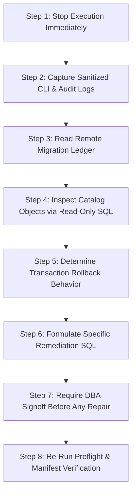

# AuroMasti v2.0.0 Beta — Hardened Migration Recovery & Partial-Failure Runbook

**Milestone:** B19.9.2.1 (Bucket 2.1)  
**Project:** AuroMasti (formerly AuroMind)  
**Workspace:** `C:\AuroMindPortal`  
**Target Project:** `rlqrtbjynaihdspbqtce` (ap-southeast-1)  
**Target Release:** Version 2.0.0 Beta (Target Deadline: November 30, 2026)  
**Execution Boundary:** FAIL-SAFE PROCEDURAL GOVERNANCE — ZERO LIVE MUTATIONS  

---

## 1. Explicit Prohibition of Blanket Schema Drops

> [!CAUTION]
> **CRITICAL ARCHITECTURAL SAFETY RULE — BLANKET SCHEMA DROPS STRICTLY PROHIBITED**  
> Under no circumstances may operators or release engineers execute blanket public schema destruction statements, including:  
> `DROP SCHEMA public CASCADE; CREATE SCHEMA public;`  
> or  
> `DROP TABLE ... CASCADE` loops across the database.
>
> **Technical Justification:**
> 1. **Revocation of Managed Role Grants**: A blanket `DROP SCHEMA public CASCADE` revokes default grants and usage privileges automatically configured by Supabase for internal roles (`anon`, `authenticated`, `service_role`, `authenticator`, and `postgres`).
> 2. **Destruction of Extension Linkages**: Extensions installed or referenced in public (e.g. `pgcrypto`, `uuid-ossp`) are dropped or orphaned.
> 3. **Destruction of Storage and Auth Foreign Keys**: Supabase Auth (`auth.users`) and Storage (`storage.buckets`, `storage.objects`) establish cross-schema foreign keys and triggers with `public` tables. Cascading drops corrupt internal metadata and trigger definitions in the managed Supabase control plane.
> 4. **Supabase CLI Ledger Invalidation**: The migration ledger `supabase_migrations.schema_migrations` resides outside `public`, meaning that dropping `public` creates a fatal divergence where the ledger reports migrations as applied, but the underlying tables are missing (`SCHEMA_HISTORY_DIVERGENCE`).

---

## 2. Fail-Safe Partial-Failure Recovery Procedure

If an error occurs during `supabase db push` or programmatic migration execution, operators must follow this strict 8-step fail-safe procedure:



### Step 1: Stop Execution Immediately
- Do **not** attempt an immediate re-run.
- Do **not** run `supabase db push` again.
- Do **not** run `supabase migration repair`.
- The execution runner fails closed and sets `decision: "REJECTED"` in [`supabase/authorization_audit.log`](file:///C:/AuroMindPortal/supabase/authorization_audit.log).

### Step 2: Capture Sanitized CLI Output & Audit Identifiers
- Copy the console output, ensuring secrets remain masked (`[REDACTED]`).
- Record the exact failure timestamp, error code, and PostgreSQL error message (e.g., `42P07 table already exists`, `42704 type does not exist`).
- Check `supabase/authorization_audit.log` for the recorded event.

### Step 3: Read the Remote Migration Ledger
- Query the remote migration tracking ledger using the Session Pooler connection:
  ```powershell
  $env:PGPASSWORD = $env:SUPABASE_DB_PASSWORD
  npx supabase migration list --remote="postgresql://postgres.rlqrtbjynaihdspbqtce@aws-1-ap-southeast-1.pooler.supabase.com:5432/postgres?sslmode=verify-full&sslrootcert=C:/AuroMindPortal/prod-ca-2021.crt"
  ```
- Identify the exact migration boundary:
  - Migrations $V_1 \dots V_{k-1}$: Marked as `applied`.
  - Migration $V_k$: The migration that failed; must be listed as unapplied or failed.
  - Migrations $V_{k+1} \dots V_{10}$: Unapplied.

### Step 4: Inspect Remote Catalog Objects via Read-Only SQL
- Execute affirmative catalog queries via Session Pooler or Dashboard SQL Editor to verify the physical state of tables, functions, and policies:
  ```sql
  -- 1. Check tables created
  SELECT table_schema, table_name 
  FROM information_schema.tables 
  WHERE table_schema = 'public' 
  ORDER BY table_name;

  -- 2. Check RLS status
  SELECT tablename, rowsecurity 
  FROM pg_tables 
  WHERE schemaname = 'public';

  -- 3. Check functions created
  SELECT proname, proconfig 
  FROM pg_proc 
  WHERE pronamespace = 'public'::regnamespace;
  ```

### Step 5: Determine Transaction Rollback Behavior for Migration $V_k$
- In PostgreSQL, DDL executed inside an explicit or implicit transaction (`BEGIN ... COMMIT`) rolls back atomically upon error.
- Verify whether the failed statement in $V_k$ was completely rolled back:
  - If $V_k$ rolled back cleanly, zero objects from $V_k$ exist in the catalog.
  - If $V_k$ contained non-transactional statements or was preceded by partial operations, document any leftover orphan objects.

### Step 6: Formulate Specific Remediation SQL (No Blanket Drops)
- Create a dedicated, reviewable remediation patch addressing the root cause of the failure in $V_k$ (e.g. syntax adjustment, extension permission).
- Target **only** the specific defective object. Never drop unrelated tables created by $V_1 \dots V_{k-1}$.

### Step 7: Strict Prohibition on Unreviewed `migration repair`
- **Rule**: `supabase migration repair --status applied <version>` merely alters bookkeeping; it does **not** execute SQL.
- Marking a version as applied without proof that all expected objects exist is strictly prohibited.
- A repair command may only be executed if the DBA and Product Owner sign a specific reconciliation decision record.

### Step 8: Re-Run Preflight & Manifest Verification Before Retry
- Re-run `npm run migrate:preflight:remote`.
- Confirm that the preflight state accurately reflects the partial state (e.g., `MIGRATIONS_PENDING`).
- Once the fix is applied and verified, request fresh Product Owner approval within the 60-minute window and resume execution.

---

## 3. Transactional Behavior Analysis of the 10 Canonical Migrations

Operators must understand the specific PostgreSQL and Supabase CLI transactional characteristics across the 10 migrations:

| Seq | Migration Filename | Transaction Boundary | Key Operations | Transactional Quirks & Special Handling |
|:---:|:---|:---:|:---|:---|
| **01** | `20261120000001_b5_core_schema.sql` | Per-file transaction | `CREATE EXTENSION pgcrypto`, 10 tables, 15 RLS policies, handles user triggers | `CREATE EXTENSION` is transactional in PostgreSQL, but if pgcrypto is already provisioned by Supabase in `extensions` schema, `IF NOT EXISTS` is a no-op. Full rollback on table failure. |
| **02** | `20261120000002_b8_rate_limiting.sql` | Per-file transaction | `telemetry_rate_limits`, `check_telemetry_rate_limit` | Atomic. Complete rollback on failure. |
| **03** | `20261120000003_b13a_telemetry_rls_hardening.sql` | Per-file transaction | RLS policies on `auromind_telemetry` | Atomic. Alter table and policy creation roll back together. |
| **04** | `20261120000004_b13b_telemetry_retention.sql` | Per-file transaction | `telemetry_daily_aggregates`, prune functions | Atomic. |
| **05** | `20261122000001_b18c_profile_rls_separation.sql` | Per-file transaction | `user_private_settings`, profile triggers | Atomic. |
| **06** | `20261122000002_b18c_telemetry_token_bucket.sql` | Per-file transaction | `CREATE UNLOGGED TABLE telemetry_rate_buckets` | DDL creation of unlogged tables is transactional in Postgres. However, data in unlogged tables is not written to WAL (by design, to eliminate telemetry write-amplification). |
| **07** | `20261122000003_b18c_telemetry_search_path_hardening.sql` | Per-file transaction | `ALTER FUNCTION ... SET search_path` | Atomic. Function configuration change rolls back on failure. |
| **08** | `20261122000004_b18d_telemetry_token_bucket_input_validation.sql` | Per-file transaction | Replaces function body with parameter validation | Atomic function replacement. |
| **09** | `20261123000001_b19_5_05_db_integrity_and_rls_hardening.sql` | Per-file transaction | FK cascades, drops deprecated columns, 100% RLS across all 15 public tables | Large migration (35.6 KiB). Runs inside a single transaction. If any FK constraint fails, the entire hardening script rolls back, leaving previous tables intact. |
| **10** | `20261123000002_b19_5_06_storage_buckets_and_rls.sql` | Per-file transaction | `do $$ begin ... end; $$;` anonymous PL/pgSQL block | Anonymous PL/pgSQL block executes within the transaction. Any unhandled exception aborts the block and rolls back bucket insertions and storage policies. |

### CLI Execution Boundary Note:
`supabase db push` executes each file sequentially in its own transaction block. It does **not** wrap all 10 files in a single cross-file transaction. Therefore, partial failure between files is naturally isolated: preceding committed files remain committed, while the failed file is completely rolled back.
