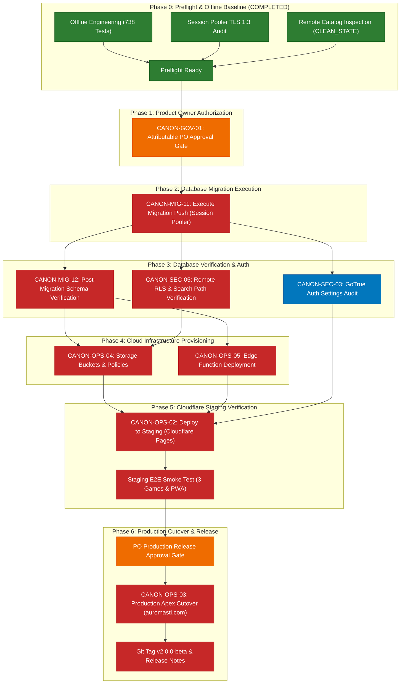

# AuroMasti v2.0.0 Beta — Master Dependency & Critical Path Analysis

**Project:** AuroMasti (formerly AuroMind)  
**Document:** Master Dependency Graph, Critical Path & Operational Recovery Runbook  
**Workspace:** `C:\AuroMindPortal`  
**Branch:** `dev/studio-integration`  
**Remote:** `origin`  
**Baseline HEAD Commit:** `59473bc2c03283bcd6ebd3f7512903d252fb1601`  
**Evaluation Date:** November 28, 2026  
**Target Release Deadline:** November 30, 2026 (Version 2.0.0 Beta)  
**Commercial Gate:** `COMMERCIAL_GATE_ENABLED=false` (Strictly Preserved)  
**Cloud Mutation Policy:** FAIL-CLOSED — ZERO MUTATIONS WITHOUT ATTRIBUTABLE PO APPROVAL  

---

## 1. Executive Summary & Purpose

The purpose of this document is to establish the authoritative, end-to-end dependency chain from the current verified offline/preflight state through the final production launch of AuroMasti v2.0.0 Beta on November 30, 2026.

Every task, automated check, governance approval, database migration, cloud deployment, and verification milestone is modeled with explicit prerequisites, slack calculation (float), risk mitigations, and recovery procedures.

### Key Milestones Achieved (November 28, 2026 Baseline):
- **Offline Engineering Closure**: 45 automated test suites, 738 passing tests (100% pass rate).
- **Session Pooler Verification**: Zero-exposure TLS 1.3 connectivity verified on `aws-1-ap-southeast-1.pooler.supabase.com:5432` with `prod-ca-2021.crt`.
- **Remote Catalog Preflight**: Live catalog verified in `CLEAN_INITIAL_STATE` (0 applied migrations, 10 pending, 0 public user tables).
- **Sacred Invariants Reconciled**: Flora DB locked (`games/auromatch/src/models/floraDatabase.js`, SHA-256 `689d035c...`); VAK formally excluded from beta release; Sankalpa 100% local-first PBKDF2/AES-GCM locked.

---

## 2. Global Critical Path Architecture

The Critical Path represents the sequence of dependent tasks that directly determines the minimum time required to launch AuroMasti v2.0.0 Beta. Any delay in a task on the critical path directly slips the release date.

### Critical Path Sequence (Float = 0):
1. **`CANON-GOV-01`**: Product Owner Formal Authorization Gate  
   $\rightarrow$ 2. **`CANON-MIG-11`**: Remote Database Migration Push (Session Pooler)  
   $\rightarrow$ 3. **`CANON-MIG-12`**: Post-Migration Database Schema & RLS Verification  
   $\rightarrow$ 4. **`CANON-OPS-04`**: Supabase Storage Buckets Provisioning & RLS Verification  
   $\rightarrow$ 5. **`CANON-OPS-05`**: Edge Function Deployment (`telemetry-ingest`)  
   $\rightarrow$ 6. **`CANON-OPS-02`**: Cloudflare Pages Staging Deployment & E2E Smoke Test  
   $\rightarrow$ 7. **`CANON-OPS-03`**: Production Cutover, Apex DNS Verification & Beta Tagging  



---

## 3. Detailed Execution Phases & Dependency Mapping

### Phase 0: Preflight Baseline (Status: 100% COMPLETE)
- **Prerequisites**: Offline test regression, TLS handshake verification, remote catalog preflight.
- **Tasks Completed**:
  - `45/45` automated test suites passing (738/738 tests).
  - Supabase CLI 3.4.0 verified with in-memory `PGPASSWORD` and Session Pooler URL.
  - Remote database catalog verified as `CLEAN_INITIAL_STATE` (0 applied, 10 pending).
  - Flora DB canonical hash verified: `689d035cd52abd8d342528d8c5f61f298916b8052b8287450be4931cf8ae1a3a`.
  - VAK excluded from active release catalogue; source code preserved in `games/vak/`.
- **Exit Condition**: All Phase 0 health checks PASS. Preflight report generated.

---

### Phase 1: Product Owner Authorization Gate (`CANON-GOV-01`)
- **Critical Path**: YES (Slack: 0 hours)
- **Prerequisites**: Phase 0 Preflight Report, Master Acceptance Matrix, Master Issue Register.
- **Required Action**: Product Owner formally signs authorization record:
  ```json
  {
    "approvedBy": "Product Owner",
    "approvedAt": "2026-11-28T15:00:00.000Z",
    "approvedManifestSha256": "f55231159389f9d5549713ee83c783c1c7130dc7454058c8195140ae529899ea",
    "migrationSetCount": 10,
    "targetProjectRef": "rlqrtbjynaihdspbqtce",
    "explicitStatement": "I AUTHORIZE MIGRATION EXECUTION FOR AUROMASTI"
  }
  ```
- **Validity Rule**: Preflight report must be $< 30$ minutes old; PO signature must be $< 60$ minutes old at time of execution.
- **Exit Condition**: Record cryptographically logged in `supabase/authorization_audit.log`.

---

### Phase 2: Remote Database Migration Push (`CANON-MIG-11`)
- **Critical Path**: YES (Slack: 0 hours)
- **Prerequisites**: Phase 1 PO Authorization.
- **Execution Command**:
  ```powershell
  Set-Location C:\AuroMindPortal
  node scripts/migration-workflow.mjs --execute
  ```
- **Underlying Safe CLI Call**:
  ```powershell
  $env:PGPASSWORD = $env:SUPABASE_DB_PASSWORD
  npx supabase db push --remote="postgresql://postgres.rlqrtbjynaihdspbqtce@aws-1-ap-southeast-1.pooler.supabase.com:5432/postgres?sslmode=verify-full&sslrootcert=C:/AuroMindPortal/prod-ca-2021.crt"
  ```
- **Safeguards**:
  - In-memory `PGPASSWORD` delivery (zero exposure in process list / command lines).
  - Strict TLS 1.3 CA certificate verification with `prod-ca-2021.crt`.
  - Sequential lexical execution of all 10 canonical migrations.
- **Exit Condition**: `supabase migration list --remote` reports all 10 migrations applied; exit code 0.

---

### Phase 3: Post-Migration Schema Verification (`CANON-MIG-12`, `CANON-SEC-05`)
- **Critical Path**: YES (Slack: 0 hours)
- **Prerequisites**: Phase 2 Migration Push.
- **Execution Action**: Execute `supabase/verify_remote_schema.sql` via Session Pooler or Dashboard SQL Editor.
- **Verification Gates**:
  1. Exactly 15 tables present in `public` (14 logged, 1 unlogged `telemetry_rate_buckets`).
  2. Exactly 100% of public tables have Row-Level Security enabled (`rowsecurity = true`).
  3. All `SECURITY DEFINER` functions have hardened `search_path = pg_catalog, public`.
  4. Foreign key cascade rules and indexes match specification.
- **Exit Condition**: Verification SQL returns zero defects or missing objects.

---

### Phase 4: Cloud Infrastructure & Services Provisioning (`CANON-OPS-04`, `CANON-OPS-05`)
- **Critical Path**: YES (Slack: 0 hours)
- **Prerequisites**: Phase 3 Schema Verification.
- **Parallel Sub-Tracks**:
  - **Track 4A: Storage Buckets (`CANON-OPS-04`)**:
    - Verify `avatars`, `user-artwork`, and `mandala-cloud-sync` buckets exist.
    - Verify storage RLS policies restrict read/write to `auth.uid()`.
  - **Track 4B: Edge Function Deployment (`CANON-OPS-05`)**:
    - Deploy `telemetry-ingest` function:
      ```powershell
      npx supabase functions deploy telemetry-ingest --project-ref rlqrtbjynaihdspbqtce
      ```
    - Verify CORS headers and token-bucket rate limiting via mock payload.
  - **Track 4C: GoTrue Auth Settings (`CANON-SEC-03`)** *(Parallel Slack: 2 hours)*:
    - Confirm Site URL: `https://auromasti.com`.
    - Confirm Redirect URLs: `https://staging.auromasti.pages.dev/**`, `http://localhost:5173/**`.
- **Exit Condition**: Storage buckets and Edge Function operational with zero permission leakage.

---

### Phase 5: Cloudflare Staging Deployment & Smoke Test (`CANON-OPS-02`)
- **Critical Path**: YES (Slack: 0 hours)
- **Prerequisites**: Phase 4 Infrastructure Complete.
- **Execution Action**: Trigger deployment to Cloudflare Pages (`staging.auromasti.pages.dev`).
- **Verification Matrix**:
  1. Staging build completes cleanly with zero errors.
  2. Edge headers verified: `Content-Security-Policy`, `X-Content-Type-Options: nosniff`, `X-Frame-Options: SAMEORIGIN`.
  3. Service Worker installs cleanly; `/games/*` routes bypassed; offline launch verified.
  4. Launch and play all 3 launch games:
     - **AuroMandala**: Palette state, brush strokes, undo/redo, local save.
     - **MaaMATCH**: Botanical card matching, audio cues, theme persistence.
     - **MaaBLOCK**: Grid placement, tile-used-once rule, score envelope, theater exit postMessage (`AUROMIND_CLOSE_THEATER`).
  5. Sankalpa Vault: Passphrase set, PBKDF2 key derivation, local save, zero network transmission.
- **Exit Condition**: QA Lead signs off on Staging Smoke Test.

---

### Phase 6: Production Cutover & Release (`CANON-OPS-03`)
- **Critical Path**: YES (Slack: 0 hours)
- **Prerequisites**: Phase 5 Staging Signoff + Formal PO Production Release Signoff.
- **Execution Actions**:
  1. Promote verified staging build to production in Cloudflare Pages.
  2. Verify apex domain routing: `https://auromasti.com`.
  3. Verify TLS certificate resolution and edge caching.
  4. Tag git release:
     ```powershell
     git tag -a v2.0.0-beta -m "Release AuroMasti v2.0.0 Beta"
     git push origin v2.0.0-beta
     ```
- **Exit Condition**: `https://auromasti.com` serving live production traffic with zero defects.

---

## 4. Float & Slack Analysis

| Phase / Task ID | Task Description | Duration | Early Start | Early Finish | Late Start | Late Finish | Total Float (Slack) | Critical? |
| :--- | :--- | :---: | :---: | :---: | :---: | :---: | :---: | :---: |
| **CANON-GOV-01** | PO Authorization Signoff | 1.0 h | T+0.0 | T+1.0 | T+0.0 | T+1.0 | **0.0 h** | **YES** |
| **CANON-MIG-11** | Database Migration Push | 0.5 h | T+1.0 | T+1.5 | T+1.0 | T+1.5 | **0.0 h** | **YES** |
| **CANON-MIG-12** | Schema & RLS Verification | 0.5 h | T+1.5 | T+2.0 | T+1.5 | T+2.0 | **0.0 h** | **YES** |
| **CANON-SEC-03** | GoTrue Auth Configuration | 0.5 h | T+2.0 | T+2.5 | T+3.0 | T+3.5 | **1.0 h** | NO |
| **CANON-OPS-04** | Storage Buckets Verification | 0.5 h | T+2.0 | T+2.5 | T+2.0 | T+2.5 | **0.0 h** | **YES** |
| **CANON-OPS-05** | Edge Function Deployment | 0.5 h | T+2.5 | T+3.0 | T+2.5 | T+3.0 | **0.0 h** | **YES** |
| **CANON-OPS-02** | Staging Deploy & Smoke Test | 1.5 h | T+3.0 | T+4.5 | T+3.0 | T+4.5 | **0.0 h** | **YES** |
| **PO-GATE-PROD** | PO Production Release Signoff | 0.5 h | T+4.5 | T+5.0 | T+4.5 | T+5.0 | **0.0 h** | **YES** |
| **CANON-OPS-03** | Production Apex Cutover | 1.0 h | T+5.0 | T+6.0 | T+5.0 | T+6.0 | **0.0 h** | **YES** |
| **TOTAL** | **Target Release Window** | **6.0 h** | — | — | — | — | — | — |

*Target release deadline: November 30, 2026. Total execution window required is 6.0 operating hours.*

---

## 5. Rollback Procedures & Failure Recovery Runbook

To guarantee operational resilience, every critical phase is equipped with a deterministic rollback procedure.

### 5.1 Database Migration Failure Rollback
- **Failure Trigger**: `supabase db push` exits with non-zero code or post-migration SQL verification fails.
- **Immediate Action**:
  1. **HALT EXECUTION**: Do NOT attempt to rerun migrations or apply blanket `migration repair`.
  2. **Inspect Migration Ledger**:
     ```powershell
     npx supabase migration list --remote="<pooler-url>"
     ```
  3. **Assess State**:
     - If failure occurred during migration $V_k$, PostgreSQL automatically rolls back the explicit transaction for migration $V_k$.
     - Migrations $V_1$ through $V_{k-1}$ remain applied; $V_k$ through $V_{10}$ remain unapplied.
  4. **Ledger Reconciliation (If Dashboard SQL Editor Fallback Used)**:
     - Execute the Granular Per-Migration Verification SQL from [`B19_8_3_REMOTE_PREFLIGHT_RUNBOOK.md`](file:///C:/Users/gopal_ogmm83y/.gemini/antigravity/brain/a97c0053-3700-41f3-a6aa-40bddb52f5bf/B19_8_3_REMOTE_PREFLIGHT_RUNBOOK.md).
     - Only reconcile migrations whose catalog objects have been positively confirmed.
  5. **Emergency Schema Reset (Pre-Production Only)**:
     - Since the database was verified in `CLEAN_INITIAL_STATE` with zero existing user data, if catastrophic schema corruption occurs, the DBA can drop public schema tables and re-execute clean push.

---

### 5.2 Edge Function Deployment Rollback
- **Failure Trigger**: `telemetry-ingest` fails runtime invocation or causes 500 errors.
- **Rollback Action**:
  1. Re-deploy previous known-good version from commit `59473bc2c03283bcd6ebd3f7512903d252fb1601`.
  2. Client-side SDK automatically buffers telemetry locally in IndexedDB when the ingest endpoint returns 5xx, preventing data loss.

---

### 5.3 Cloudflare Staging / Production Deployment Rollback
- **Failure Trigger**: Browser smoke tests fail, service worker fails to precache, or CSP header blocks valid assets.
- **Rollback Action**:
  1. In Cloudflare Pages Dashboard (`Workers & Pages -> auromasti -> Deployments`):
     - Identify previous healthy deployment.
     - Click **Rollback to this deployment**.
     - Propagation takes $< 30$ seconds globally across Cloudflare edge nodes.
  2. Client Service Worker:
     - The service worker contains a fail-closed install guard (`E4`); if a new shell asset is broken, the worker refuses to activate, leaving the previous cache intact.

---

## 6. Recovery Time Objective (RTO) & Recovery Point Objective (RPO)

| Subsystem / Layer | Failure Mode | Recovery Procedure | Target RTO | Target RPO |
| :--- | :--- | :--- | :---: | :---: |
| **Client Frontend (PWA / Edge)** | Broken asset, bad JS build, or CSP mismatch | Instant Cloudflare Pages deployment rollback | **< 2 minutes** | **0 seconds** (Static assets) |
| **Client Local Data (Sankalpa / Saves)** | Browser storage pressure or network drop | In-memory cache + IndexedDB multi-snapshot fallback | **Instant (0 s)** | **0 seconds** (100% local persistence) |
| **PostgreSQL Database** | Migration transaction failure | Transaction abort / point-in-time restore | **< 15 minutes** | **< 60 seconds** (WAL replication) |
| **Storage Buckets** | Corrupted upload or missing policy | Re-apply storage RLS policy via SQL script | **< 5 minutes** | **0 seconds** (Zero data deleted) |
| **Edge Functions** | Runtime exception or rate limit bug | Cloudflare Pages / Supabase CLI redeploy | **< 5 minutes** | **0 seconds** (Buffered in IndexedDB) |
| **DNS / Apex Domain** | DNS misconfiguration or SSL expiration | Cloudflare CNAME / Apex DNS routing reversion | **< 10 minutes** | **N/A** |

---

## 7. Operational Readiness Checklist for November 30, 2026

- [x] **Offline Test Suite Passing**: 45/45 suites, 738/738 tests passing.
- [x] **Session Pooler TLS 1.3 Verified**: Primary AWS pooler port 5432 with `prod-ca-2021.crt`.
- [x] **Remote Database State Verified**: `CLEAN_INITIAL_STATE` (0 applied, 10 pending, 0 user tables).
- [x] **Sacred Invariants Reconciled**: Flora DB hash verified; VAK excluded from beta; Sankalpa privacy locked.
- [x] **Commercial Gate Enforced**: `COMMERCIAL_GATE_ENABLED=false` preserved.
- [ ] **Phase 1 PO Authorization**: Awaiting digital signoff from Product Owner (`CANON-GOV-01`).
- [ ] **Phase 2 Migration Push**: Scheduled immediately upon PO authorization.
- [ ] **Phase 3 Schema Verification**: Verification script ready.
- [ ] **Phase 4 Storage & Edge Deployment**: Configured and ready to deploy.
- [ ] **Phase 5 Staging Smoke Test**: Cloudflare Pages staging ready.
- [ ] **Phase 6 Production Cutover**: Target launch deadline November 30, 2026.
